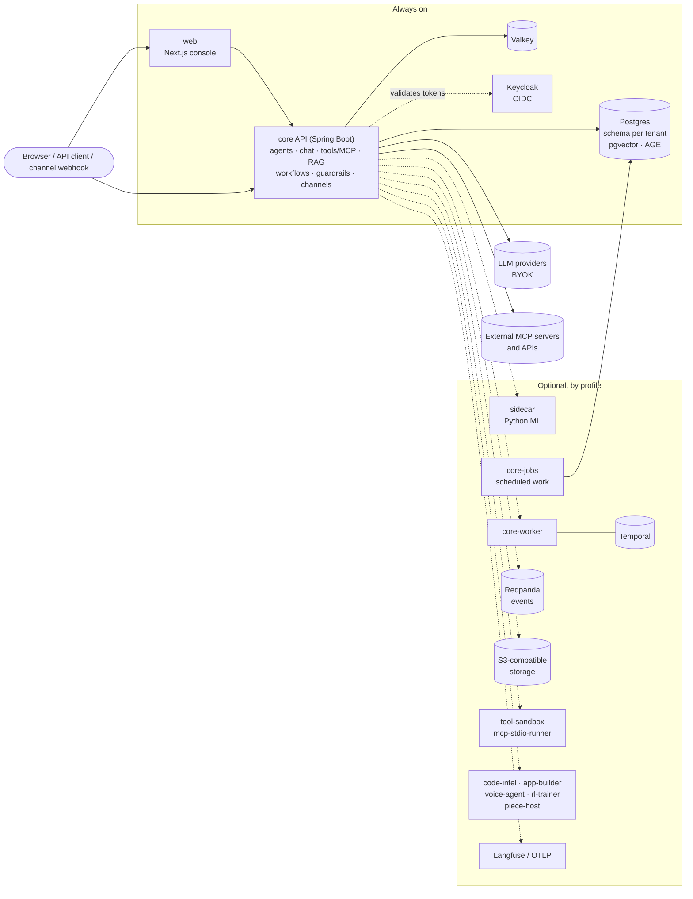

# VegaDūta

**An open-source, multi-tenant platform for building AI agents, wiring them into workflows with human approval, grounding them in your own data, and reaching them over the channels your users already use.**

[](https://github.com/CD-LC/vegaduta/actions/workflows/ci.yml)
[](https://github.com/CD-LC/vegaduta/actions/workflows/codeql.yml)
[](https://scorecard.dev/viewer/?uri=github.com/CD-LC/vegaduta)
[](LICENSE)
[](https://github.com/CD-LC/vegaduta/releases)
[](deploy/helm/README.md)

VegaDūta is a self-hostable agent platform: a Java 21 / Spring Boot core, one Next.js console (the tenant app, the public pages and the platform-admin area under `/platform-admin`), and twelve optional services in Python and Node. It speaks the open agent standards (MCP as client and server, A2A, AG-UI, OpenTelemetry `gen_ai` attributes), keeps every tenant in its own Postgres schema, and runs from a five-container laptop install up to a Helm deployment on Kubernetes.

<!-- Screenshots: add images under docs/assets/ and uncomment.


-->

## Quickstart (Lite)

Requirements: Docker with Compose v2, 15 GB of free disk, and an LLM provider key or a local Ollama. Building the images from source needs **8 GB of memory available to Docker**; the running Lite stack uses less.

Releases are published on the [Releases](https://github.com/CD-LC/vegaduta/releases) page with signed images. The installer downloads the latest release (or the one you name with `--version X.Y.Z`), checks it against the release's `SHA256SUMS` and starts Lite:

```sh
curl -fsSL https://raw.githubusercontent.com/CD-LC/vegaduta/main/install.sh | sh -s -- --lite
```

Without `--lite` or `--full` the installer sets up Personal mode (below). From a git checkout:

```sh
git clone https://github.com/CD-LC/vegaduta.git
cd vegaduta
./scripts/vegaduta up --lite
```

In a checkout with no version pinned, `up` uses the latest published release and writes it to `deploy/compose/.env`. Add `--build` to build every image from your checkout instead. The first build compiles the Java core and the Next.js console inside Docker: expect roughly 20 to 40 minutes on a typical laptop. The first start adds a few minutes (database migrations); later starts take about a minute. These are rough figures, not benchmarks.

`up` generates `deploy/compose/.env` with every secret the compose files need, checks your machine (`doctor`), asks Docker Compose whether anything is still missing, starts the stack and waits until every service is healthy. Then:

1. Open <http://localhost:3000> and **Sign up**. The first account creates your organisation.
2. `./scripts/vegaduta make-admin you@example.com` to become the platform operator.
3. Add an LLM provider key (Anthropic, OpenAI, Gemini, Ollama, ...) in the console and create an agent. No key? Start with `./scripts/vegaduta up --lite --local-ai` to run a free local model, or open `/edge` to run one in your browser: [Run free with local models](docs/local-models.md).

### Personal mode (one person, one machine)

**Not a developer? Use the Setup app.** Download it for your system from the [Releases](https://github.com/CD-LC/vegaduta/releases) page: `VegaDuta-Setup-<version>.dmg` on macOS, `vegaduta-setup-windows-amd64.zip` on Windows, `vegaduta-setup-linux-<arch>.tar.gz` on Linux. Open it and follow the page that appears in your browser. It checks your computer, installs and starts Docker Desktop on macOS and Windows (on Windows it also turns on WSL2; on Linux it shows the command to install Docker), downloads the verified release, starts VegaDūta and hands you the link where you choose your password. It also sets up a free local AI model, so you need no account or API key. When a start fails, it finds the usual causes (a busy port, a database left by an earlier install, a missing secret), repairs them and tries again. The app is not yet code-signed, so macOS and Windows will warn once: choose "Open anyway" (macOS) or "More info", then "Run anyway" (Windows). Terminal users get the same result with `curl -fsSL https://raw.githubusercontent.com/CD-LC/vegaduta/main/install.sh | sh`.

If it is just you, skip Keycloak:

```sh
./scripts/vegaduta personal
```

It starts Postgres, Valkey, core and web (about 2.5 GB of container limits), plus private web search and the connector runner. It picks a free local model that fits your computer's memory and downloads it (on macOS and Windows it installs Ollama on the computer when it is missing; `--cloud` skips the model). Then it prints a one-time link where you choose the password of the single local account. Your secrets are also kept outside the install folder (`~/.config/vegaduta/secrets.env`, or `%LOCALAPPDATA%\VegaDuta\secrets.env` on Windows), so a re-install reuses them and can read your data. Add `--native-core` to run core on your machine's JVM (Java 21+) instead of in a container, and `--local-ai=host` to use an Ollama you already run. Requirements, local sign-in, picking a local model, skills, the Signal, Matrix and iMessage channels, sandbox levels and the honest limitations are in [docs/personal-mode.md](docs/personal-mode.md); what taint tracking, the sandbox and pairing do and do not protect against is in [docs/security-model.md](docs/security-model.md). Add `--build` to build the images from your checkout instead of using the published release.

On Windows use `.\scripts\vegaduta.ps1` (the Setup app runs it for you). It has the main commands (`personal`, `up`, `down`, `status`, `logs`, `doctor`, `backup`, `restore`, `upgrade`, `make-admin`) with PowerShell-style flags such as `-Lite`, `-Build`, `-Profile tools` and `-Cloud`; `models pull TAG` and `-Search` (private web search) exist there too; `models list`, `restart`, `seed-demo`, `projects` and `--native-core` are bash-only (use WSL2). `upgrade -Version X.Y.Z` downloads and verifies that release's files before it re-pins the images. The full walkthrough is in [docs/getting-started.md](docs/getting-started.md).

## Install tiers

All four tiers run the same images. The Compose tiers use the published release pinned in `deploy/compose/.env` (the latest one when none is pinned); `--build` builds the images from your checkout instead.

| Tier | For | What runs | Command |
|---|---|---|---|
| **Personal** | one person on one machine | Postgres (pgvector + Apache AGE), a 128 MB Valkey, core and web, plus private web search, the connector runner and a free local model by default. No Keycloak: core holds one local account. Taint tracking enforced, an OS sandbox for STDIO MCP servers, skill learning on, billing off. See [Personal mode](docs/personal-mode.md). | `./scripts/vegaduta personal` |
| **Lite** | trying it, local development | 5 containers: Postgres (pgvector + Apache AGE), Valkey, Keycloak (dev mode), core (one process), web. Optional `rag` profile adds the ML sidecar. | `./scripts/vegaduta up --lite` |
| **Full** | self-hosting on one server | Lite plus PgBouncer, S3-compatible storage (SeaweedFS), a Keycloak database and the sidecar. Opt-in profiles: `temporal`, `events`, `jobs`, `observability`, `tracing`, `voice`, `rl`, `code-intel`, `builder`, `sandbox`, `tools`, `browser`. | `./scripts/vegaduta up --full --profile temporal` |
| **Kubernetes** | production, high availability | Umbrella Helm chart `vegaduta` (22 charts under `deploy/helm/charts`, counting the umbrella and the `vegaduta-lib` library chart): core API (scalable), jobs, optional Temporal worker, a migrate Job, every optional service as its own chart, an optional bundled Ollama. | `helm install vegaduta oci://ghcr.io/cd-lc/charts/vegaduta --version <version>` |

Details, sizing and upgrade paths: [docs/installation.md](docs/installation.md), [deploy/README.md](deploy/README.md), [deploy/helm/README.md](deploy/helm/README.md).

## What is in the box

Every item below maps to code in this repository. Paths are relative to the repo root.

**Agent SDKs for your own applications** (they run inside your process and need no VegaDūta server)
- `sdk/java/`: the VegaDūta Agent SDK (`io.github.cd-lc:vegaduta-agent-*`, seven modules plus a BOM), an embeddable, governance-first library: tool risk classification, human approval, budgets, idempotent effects, guardrails, hooks, audit and telemetry around Spring AI tools (or any framework via the framework-free core). One dependency and one annotation; see [sdk/java/README.md](sdk/java/README.md) and [ADR-0013](docs/architecture/ADR-0013-embeddable-agent-sdk.md). Its `vegaduta-agent-scanner` module reads a jar and prints a risk map of the `@Tool`/`@Governed` methods with a readiness score (`--fail-under` exits non-zero in CI) without changing your code.
- `sdk/python-agent/`: the same governance contracts for Python (`vegaduta_agent`: `@governed`, approval gate, effect journal, budgets, guardrails, audit), with no runtime dependencies; see [docs/sdk/python-agent-sdk.md](docs/sdk/python-agent-sdk.md). Alpha (`pyproject.toml` classifier).
- `sdk/typescript/` and `sdk/python/` are generated REST clients for the platform API ([docs/sdk/clients.md](docs/sdk/clients.md)). None of the four packages is published to Maven Central, npm or PyPI yet.

**Agents and tools**
- Agents with per-agent model, persona, tools, knowledge and skills: `core/agents`.
- 15 LLM provider integrations behind one factory interface, including Anthropic, OpenAI, Azure OpenAI, Google Vertex and Gemini, AWS Bedrock, Meta, Mistral, DeepSeek, Groq, Grok, OpenRouter, Ollama (local models), any local OpenAI-compatible server, and Sarvam: `core/providers` (`ProviderName`), `core/chat` (one chat-client factory per provider). Tenants bring their own keys (BYOK), stored AES-256-GCM encrypted: `core/crypto`.
- **MCP client** over stdio, SSE and Streamable HTTP, with per-tenant server registration, a curated catalog and search of the official MCP registry: `core/agents-tools/.../tools/DynamicMcpConnectionManager.java`, `core/mcp`.
- **MCP server**: every tenant's agents, workflows and knowledge search exposed as MCP tools at `/mcp` (Streamable HTTP, API-key auth; active with the `mcpserver` Spring profile, which the Compose and Helm defaults set). `Origin` validation is on by default; an OAuth 2.1 mode (protected-resource metadata, audience-bound tokens, scopes) exists and is off by default. Remote MCP servers get tool-definition pinning (a hash of each tool list, change audited; default mode `warn`, `enforce` withholds changed tools until an admin approves). Requirement-by-requirement status, including what is not done (the stateless 2026-07-28 revision): [docs/architecture/mcp-spec-alignment.md](docs/architecture/mcp-spec-alignment.md). Code: `core/mcpserver`, `core/mcp`.
- **OpenAPI tool import**: turn any OpenAPI 3.x or Swagger 2.0 spec into agent tools, with API-key or OAuth2 client-credential auth: `core/agents-tools/.../tools/openapi`.
- **Agent Skills** (`SKILL.md`, progressive disclosure): 27 built-in skills plus tenant-authored and imported skills: `core/agents-turn/src/main/resources/skills`, `core/agents/.../skills`.
- Custom code tools in Java or Python, run in an isolated sandbox service: `services/tool-sandbox`. Stdio MCP servers can run in a separate, seccomp-restricted runner: `services/mcp-stdio-runner`.

**Interoperability**
- **A2A**: signed agent cards at `/.well-known/agent-card.json` and per agent; the JSON-RPC binding and the HTTP+JSON/REST binding (`/api/a2a/rest`, `/api/agents/{agentId}/a2a/rest`) each offer `message/send`, `message/stream`, `tasks/get` and `tasks/cancel`; other operations answer with the spec's unsupported-operation errors and gRPC is not implemented. Status against the spec: [docs/architecture/a2a-conformance.md](docs/architecture/a2a-conformance.md). Code: `core/agents/.../a2a`.
- **AG-UI**: server-sent event runs at `/api/agents/{id}/agui/run`: `core/agents/.../agui`.
- **OpenTelemetry**: traces exported over OTLP (Langfuse or any collector), with `gen_ai.*` attributes on LLM calls: `core/chat/.../LlmMetricsAdvisor.java`.

**Workflows and governance**
- Visual workflows with 35 node types (`WorkflowNodeType`), including agent, tool, HTTP, condition, loop, parallel and fan-out, sub-flow, and **human approval** and **human input** steps: `core/workflow`, `core/approval`. Two engines: an in-process engine (default) and Temporal for durable runs (`core/app-worker`). Triggers include webhooks, schedules and HTTP polling (a Trigger node polls an http(s) URL, de-duplicates items and starts a run per new item; `PUT /api/workflows/{id}/nodes/{nodeId}/poll-trigger`, `core/workflow/.../poll`). Starter templates: `examples/workflow-templates`.
- Guardrails on inputs, outputs and tool calls: `core/guardrails`. Audit log: `core/audit`. Secret vault with rotation and redaction: `core/secrets`.
- **Tenant API keys** for headless callers (CI, partner systems): `vdak_` bearer keys minted under `/api/tenant/api-keys` (console: Administration, API keys), scoped to a subset of the issuer's own permissions, with optional expiry and rotation, stored as hashes: `core/tenancy/.../apikey`, `core/security/.../apikey`.
- **DPDP-oriented controls** (India's Digital Personal Data Protection Act; engineering controls, not a compliance claim): per-agent notice and consent for channel conversations, purpose tags, per-channel retention with nightly purge, per-contact export and erasure, and an audit export, under `/api/tenant/privacy/**`, all opt-in: `core/app/.../common/privacy`. The legal readings are marked as unconfirmed in [docs/compliance/dpdp-obligations.md](docs/compliance/dpdp-obligations.md).
- **Cost & ROI and a pilot kit**: per-agent cost from recorded tokens and a tenant-entered price table, outcome rates, and ROI computed only from values the tenant types in; a tenant-entered baseline and a one-page pilot report (HTML or PDF) per agent. Console page `/roi`, API `/api/tenant/roi/**`: `core/app/.../common/roi`, [docs/cost-and-roi.md](docs/cost-and-roi.md), [docs/pilots/README.md](docs/pilots/README.md). `scripts/vegaduta seed-demo` fills an empty tenant with fictional, watermarked example data.
- Evaluation runner (golden datasets, LLM-as-judge): `core/quality` (`eval` package, see `eval-harness.md`).

**Knowledge and memory**
- Retrieval-augmented generation on pgvector with hybrid search and optional reranking: `core/knowledge`. Document extraction, embeddings, reranking and transcription in the ML sidecar: `services/sidecar`.
- Graph memory on Apache AGE: `core/graphmemory`.

**Channels**
- Fifteen channel types (`ChannelType`): WhatsApp (Meta Cloud API and Twilio, or a linked phone by QR code), SMS and voice (Twilio), Telegram, Slack, Discord, Microsoft Teams, Messenger, Instagram, X, email, and Signal, Matrix and iMessage for personal installs: `core/omnichannel`. Outbound messages go through the same approval gate as other actions.
- **SMS** conversations (a Twilio number and a feature phone are enough; replies are cut to a configurable length): [docs/sms-channel.md](docs/sms-channel.md).
- **WhatsApp policy guard**: attaching an agent to a WhatsApp number requires a declared task, open-ended agents get a warning, template sends need an opt-in record, and Meta's per-user marketing limit errors pause marketing templates to that recipient. The Meta terms it is based on were read on 2026-10-14 and Meta changes them often: [docs/channels/whatsapp-policy.md](docs/channels/whatsapp-policy.md).
- **Edge relay**: a signed-in browser with an on-device model can be the model behind the workspace's SMS and WhatsApp numbers, with the hosted model as the fallback on the same thread: `core/omnichannel/.../relay`, [docs/edge-relay.md](docs/edge-relay.md).
- Voice agents on LiveKit: `core/voice`, `services/voice-agent`.

**Local and on-device models**
- `./scripts/vegaduta up --lite --local-ai` runs Ollama in Compose as a zero-cost platform pool; `scripts/vegaduta models list|pull|rm` manages the models listed in `deploy/models/catalog.txt`; the Helm chart can deploy a single-node Ollama (`ollama.enabled`, off by default). A browser with WebGPU can run a model on-device at `/edge`. See [docs/local-models.md](docs/local-models.md).

**Platform**
- Multi-tenancy with one Postgres schema per tenant (`SET search_path`), OIDC sign-in through Keycloak, role-based access: `core/tenancy`, `core/security`.
- Tenant console and the merged platform-admin console (`web/` under `/platform-admin`, formerly `web-admin/`).
- Optional services: code intelligence over your repositories (`services/code-intel`), an app builder (`services/app-builder`), a reinforcement-learning trainer for tool/model selection (`services/rl-trainer`, `core/rl`), and `services/piece-host` (Activepieces community pieces exposed as MCP tools; preview, off by default, not yet called against a real service).
- Console areas are listed in one module, `web/app/components/nav/navSections.ts`; list screens that were silently capped now page on the server and show a total ([docs/api/LIST-ENDPOINT-PAGING.md](docs/api/LIST-ENDPOINT-PAGING.md)).

## Architecture at a glance

The diagram is a summary of [docs/architecture/overview.md](docs/architecture/overview.md), which is the source of truth. The chat path runs **in one process**: an agent turn goes from the API through guardrails, tool calls, retrieval and the LLM call without a network hop between platform modules. Separate services exist only where they pay for themselves: async and background work, isolation of untrusted code, or a different runtime (Python ML, Node).



The core ships as three images built from one Maven reactor: `core` (the API, the diagram's core), `core-jobs` (scheduled work) and `core-worker` (Temporal worker). Schema migration is a one-shot run of the `core` image (`app.tenancy.migrate-only=true`; a Job in the Helm chart). More in [docs/architecture/overview.md](docs/architecture/overview.md).

## Deploy anywhere

One packaging per target, an open protocol at every boundary, no cloud SDK in the domain code. The decision, a per-cloud dependency matrix and the ordered list of gaps are in [ADR: cloud portability](docs/architecture/ADR-cloud-portability.md); a hands-on walkthrough of Compose and a local Kubernetes cluster is in [docs/operations/local-stack-guide.md](docs/operations/local-stack-guide.md).

| Target | How | Verification status |
|---|---|---|
| Laptop or one server | Docker Compose, Lite or Full tier | Documented and measured by hand in [docs/operations/local-stack-guide.md](docs/operations/local-stack-guide.md); `make compose-validate` checks the files render. No Compose stack is started by any automated check here. Signed images are published with each release. |
| Kubernetes | Helm umbrella chart `deploy/helm/charts/vegaduta` | Charts are linted, templated and schema-checked by `make helm-lint` and the `ci.yml` helm job (not by `make gates`); a kind-cluster walkthrough is documented in [docs/architecture/kubernetes.md](docs/architecture/kubernetes.md) with what was observed. Not run on a managed cloud cluster. |
| Managed Postgres, Redis, object storage, Kafka | Helm `global.*` values (AWS RDS / ElastiCache / S3 / MSK, Azure Flexible Server / Cache / Blob / Event Hubs, GCP Cloud SQL / Memorystore / GCS) | Configuration is implemented and covered by property-binding and emulator tests (for example Azurite for Azure Blob). **No managed cloud service has been exercised against a real account.** Keycloak is still required for identity. |
| Terraform | `infra/terraform/modules`: 30 modules (9 Azure, 8 GCP, 7 AWS, 5 Cloudflare, `upstash-redis`) | Reference modules, described as community-supported in [infra/terraform/README.md](infra/terraform/README.md); `terraform validate` only, never applied against a real account by CI. |

## Status and honesty

- **Releases are young.** Releases are published from v0.1.0 on (signed images, Helm charts, the Setup app); versions before 1.0 can change between releases. Read [CHANGELOG.md](CHANGELOG.md) before you upgrade.
- **Compiled is not tested, and tested is not run on a stack.** Unit and Testcontainers tests exist for many modules; end-to-end Playwright tests run nightly and on demand, not on every pull request.
- **Cloud portability is partial.** See the matrix in the ADR above for what works, what is partial and what is open (database IAM auth, KMS providers, non-Keycloak identity admin).
- Counts in this README come from the sources named in the table below and were taken on 2026-10-21; if they drift, the code wins.
- Several recent features are unit-tested only and have not been run against the real third-party service (WhatsApp, Twilio SMS, Google Calendar, an MCP authorization server), or on a running stack. Each feature's page says which; the `[Unreleased]` section of [CHANGELOG.md](CHANGELOG.md) repeats it per item.

| What | Count | Source |
|---|---:|---|
| Maven modules in the core reactor | 57 | `<module>` entries in `core/pom.xml` ([module graph](docs/architecture/core-module-graph.md)) |
| Flyway migration files | 382 (125 control-plane, 257 tenant; highest version V661) | `core/app/src/main/resources/db/migration` |
| REST operations in the OpenAPI description | 1,386 on 1,135 paths | `docs/api/openapi.json` |
| LLM providers selectable by a tenant | 15 (`ProviderName` has 16 values; `PLATFORM_HOSTED` is internal) | `core/providers` |
| Workflow node types | 35 | `WorkflowNodeType` |
| Channel types | 15 | `ChannelType` |
| Built-in skills | 27 | `core/agents-turn/src/main/resources/skills` |
| Helm charts | 22 (umbrella, library and component charts) | `deploy/helm/charts` |
| Terraform modules | 30 | `infra/terraform/modules` |
| Services outside core | 12 | `services/` |
| Java Agent SDK modules | 7 plus a BOM | `sdk/java/pom.xml` |

## Standards

| Standard | Support | Where |
|---|---|---|
| Model Context Protocol (client) | stdio, SSE (deprecated by the spec), Streamable HTTP; handshake-based revisions up to 2025-11-25, not the stateless 2026-07-28 revision | `core/mcp`, `core/agents/.../tools` |
| Model Context Protocol (server) | Streamable HTTP at `/mcp`; `Origin` validation; optional OAuth 2.1 mode (off by default) | `core/mcpserver` |
| Agent2Agent (A2A) | agent card, JSON-RPC and HTTP+JSON/REST bindings (send, stream, get task, cancel), signed cards; no gRPC | `core/agents/.../a2a` |
| AG-UI | SSE run + event replay | `core/agents/.../agui` |
| OpenAPI | 3.x and Swagger 2.0 import as tools | `core/agents-tools/.../tools/openapi` |
| Agent Skills (`SKILL.md`) | built-in, custom, zip import/export | `core/agents/.../skills` |
| OpenTelemetry GenAI | `gen_ai.*` attributes plus `invoke_agent` and `execute_tool` spans | `core/chat` |
| OpenID Connect | Keycloak, multiple trusted issuers | `core/security` |

## Documentation

| | |
|---|---|
| [Getting started](docs/getting-started.md) | Lite install, first agent, first workflow |
| [Installation](docs/installation.md) | Lite, Full and Kubernetes in detail |
| [Personal mode](docs/personal-mode.md), [Security model](docs/security-model.md) | One person on one machine with local sign-in; what taint tracking, the sandbox and pairing protect against |
| [Configuration](docs/configuration.md) | Profiles, environment variables, feature flags |
| [Extending](docs/extending.md) | Add tools, MCP servers, skills, LLM providers, workflow nodes, channels |
| [Architecture overview](docs/architecture/overview.md) | Deployables, data, auth, and why the hot path is not split |
| [Repository structure](docs/repository-structure.md) | Layout of the repository and how everything is linked |
| [SDKs and dependencies](docs/sdk/README.md) | Java and Python Agent SDKs, TypeScript and Python clients |
| [Cost and ROI](docs/cost-and-roi.md), [Pilots](docs/pilots/README.md) | Per-agent cost, outcome rates and the 30-day pilot process |
| [Local models](docs/local-models.md), [Edge relay](docs/edge-relay.md), [SMS](docs/sms-channel.md) | Run without a cloud key; answer SMS and WhatsApp from a browser; plain-text channel |
| [WhatsApp policy](docs/channels/whatsapp-policy.md), [DPDP obligations](docs/compliance/dpdp-obligations.md) | What the policy guard and the privacy controls do, and what is unconfirmed |
| [MCP alignment](docs/architecture/mcp-spec-alignment.md), [A2A conformance](docs/architecture/a2a-conformance.md) | Requirement-by-requirement protocol status |
| [Plugins, apps and mobile](docs/plugins-and-apps.md) | Editor and browser plugins, Android app, MCP server |
| [All docs](docs/README.md) | Index |

## Contributing

Contributions are welcome. Read [CONTRIBUTING.md](CONTRIBUTING.md) for the development setup, the checks every change must pass (`make gates`), and the DCO sign-off. Coding agents: see [AGENTS.md](AGENTS.md). Plans are in [ROADMAP.md](ROADMAP.md); how decisions are made is in [GOVERNANCE.md](GOVERNANCE.md). Questions go to GitHub Discussions; see [SUPPORT.md](SUPPORT.md).

## Security

Please report vulnerabilities privately through GitHub Security Advisories, not in public issues. See [SECURITY.md](SECURITY.md). Release images are signed with cosign (keyless) and carry SPDX SBOM and SLSA provenance attestations. How the controls map to the OWASP Agentic, LLM and MCP Top 10 lists, including what is only partly covered or open, is in [docs/security/owasp-mapping.md](docs/security/owasp-mapping.md).

## License

[Business Source License 1.1](LICENSE): free for any use except offering VegaDūta itself to third parties as a competing hosted service, and every version converts to Apache-2.0 four years after its release. The `sdk/` directory stays Apache-2.0. See [NOTICE](NOTICE) for bundled third-party components (fonts, vendored JavaScript), trademarks, and the separate-process components the deployments run under their own licenses; license texts are in [LICENSES/](LICENSES/README.md), and the commitment in [GOVERNANCE.md](GOVERNANCE.md).
