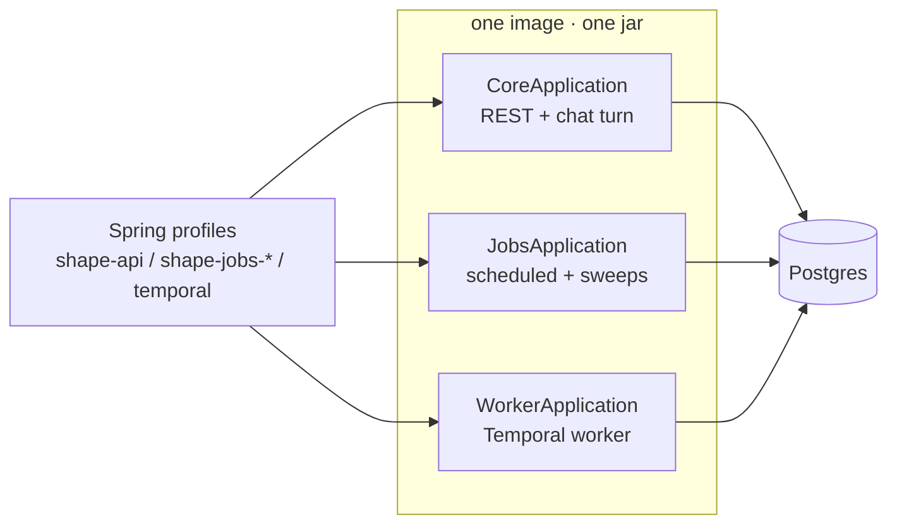
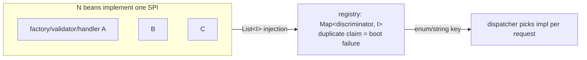
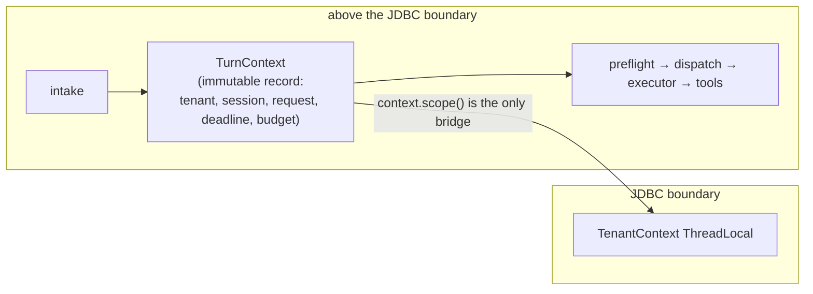
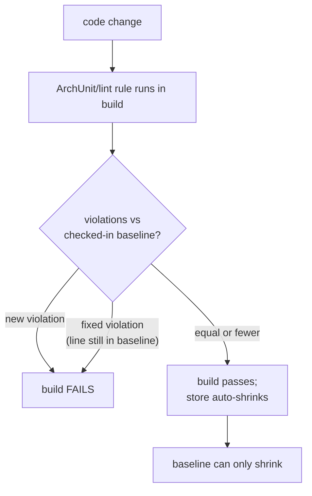
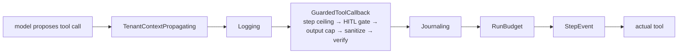
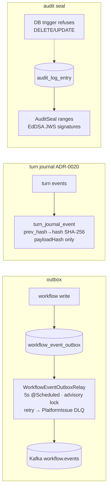
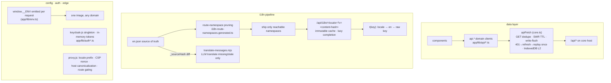
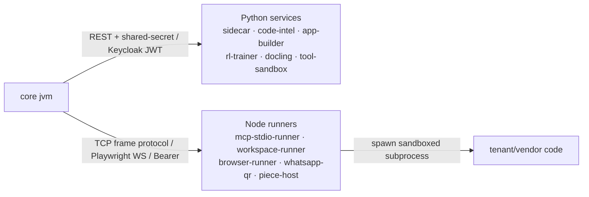

# Design-patterns review (2026-10-29)

A whole-codebase review: which design patterns VegaDūta actually uses, why each was
chosen, how consistently each is applied, and what needs correcting — with risk and
effort per item. Read-only; nothing was changed to produce it.

Sources: the ADR set (ADR-0011→0027 + named ADRs), STRUCTURAL-AUDIT-2026-10-14,
TECHNICAL-AUDIT-2026-10-19, the `archrules` suite and its frozen baselines, and a
fresh read of `core/`, `web/`, `services/`, `sdk/`, `deploy/`, `tests/`.

## Verdict

**The design is followed properly — unusually so.** The codebase's signature
decision is *conformance by construction*: almost every architectural rule is
enforced by a failing test or CI gate, not a document. The gaps are not pattern
drift; they are (a) ~420 violations *frozen* into ArchUnit baselines that are
enforced against growth but never repaired, (b) one merge seam (`platform-admin`)
with duplicated infrastructure, and (c) a small set of half-migrations that are
already documented as such. Nothing found contradicts a stated design goal; the
corrections list in §B is a burn-down, not a redesign.

---

## A. Pattern catalog — what is used, why, and where it lives in code

### A1. Modular monolith scaled by workload class ("shapes") — ADR-0014



One image, three entry points, sliced by Spring profile into
api/jobs/ingest/webhooks/billing/worker/migrate pools.

*Why:* an agent turn (guardrails → tool dispatch → retrieval → model call →
budget → audit) must stay in-process over one streamed connection — a network
hop adds latency and a mid-stream failure mode (AGENTS.md rule 6). Scaling is by
replica count and workload pool, never by splitting the turn path.

*Code:*
- `core/app/src/main/java/com/agenticai/core/CoreApplication.java`
- `core/app-jobs/.../JobsApplication.java`, `core/app-worker/.../WorkerApplication.java`
- `core/app-config/src/main/resources/application-shape-*.yml`
- `core/tenancy/.../scheduling/SchedulingRoleRegistrar.java` +
  `RoleFilteringScheduledAnnotationBeanPostProcessor.java`
- `core/app/.../archrules/ShapeInjectionPointsTest.java`,
  `JobsPoolsCoverEveryJobTest.java`

*Consistency:* high. Known open items (documented in ADR-0014): 14
advisory-locked sweeps still tick on the API shape; jobs pools not autoscaled.

### A2. Hexagonal / ports-and-adapters — kernel-owned ports, vendor satellites — ADR-0011, ADR-0023

```mermaid
flowchart TB
  subgraph kernel["kernel modules"]
    agents[agents<br/>core · hosted · quota · ports]
    agentspi[agentspi / future core-spi]
  end
  subgraph satellites["feature satellites"]
    turn[agents-turn] tools[agents-tools] browser[agents-browser]
    jobs[agents-jobs] chatport[agents-chatport] interop[agents-interop]
    studio[agents-studio] budget[agents-budget]
  end
  subgraph vendors["vendor modules"]
    sarvam elevenlabs google imagegen payments
  end
  agents -- "owns ports" --> satellites
  satellites -- "implement SPI" --> agentspi
  vendors -- "Spring starters behind SPI" --> agentspi
```

Kernel modules define SPIs; adapters live in per-vendor Maven modules or feature
satellites.

*Why:* vendors must be removable without forking (self-hosted slim builds), and
cross-module coupling must flow through contracts a consumer owns. Runtime
plugin classloading was explicitly rejected (JEP 411/486; defeats AOT).

*Code (port → adapter):*
- `core/agents/.../tools/AgentToolPort.java` → `core/agents-tools/.../AgentToolProvider.java`
- `core/agents/.../BrowserToolPort.java` → `core/agents-browser/.../BrowserToolAdapter.java`
- `core/agents/.../messaging/ChannelSendPort.java` → `core/omnichannel/.../ChannelSendPortImpl.java`
- `core/agents-turn/.../turnjournal/TurnJournal.java` → `JdbcTurnJournal.java` / `InMemoryTurnJournal.java`
- `core/admin/.../identity/IdentityUserAdminPort.java` + `IdentityProviderAdminPort.java`
  → `keycloak/KeycloakAdminClient.java` / `auth0/Auth0UserAdminClient.java` /
  `localauth/LocalUserAdminClient.java` (selected by `app.identity.provider`)
- `core/crypto/.../KeyManagementProvider.java` → Local / AWS KMS / GCP KMS / Azure KV
- Boundary tests: `core/app/.../archrules/ModuleBoundaryRulesTest.java` (kernel→vendor
  store is **empty** — clean)

*Residual:* `IdentityUserAdminPort` still returns Keycloak-named types
(documented compat shim); `sarvam` keeps one class dependent on `agents`.

### A3. Strategy + Spring-list registry — the dominant extension idiom



Every extension point: interface with a discriminator method → inject `List<I>`
→ index into a `Map` → duplicate claims fail at boot.

*Why:* "add a bean, don't touch the registry" — new providers/channels/node types
land without editing dispatch code.

*Code:*
- `core/chat/.../ChatClientRegistry.java` — `Map<ProviderName, AgentChatClientFactory>` (~15 impls)
- `core/providers/.../ProviderService.java:77` — `supportedProvider()` → validators map
- `core/providers/.../ProviderCredentialResolver.java:75` — `EnumMap` + explicit dup error
- `core/workflow/.../WorkflowNodeExecutor.java:98` — `NodeHandler.nodeTypes()` map
- `core/approval/.../ApprovalActionExecutorRegistry.java` — ~20 impls, exact +
  family (`mcp_tool.*`, `workflow.node.*`) matching
- `core/guardrails/.../ContentGuardrailEngine.java:42` — `ContentGuardrailType` map
- `core/crypto/.../EnvelopeEncryptionService.java` — per-record `providerId()` routing
- Enum taxonomies feeding them: `ProviderName` (16), `WorkflowNodeType` (~30 with
  `fromWire`), `ChannelType` (14)

*Documented exceptions:* `ProviderName.PLATFORM_HOSTED` (telemetry marker, no
factory), `SARVAM`'s own `SarvamCredential` table.

### A4. Schema-per-tenant + ThreadLocal context + enforced propagation

```mermaid
sequenceDiagram
  participant R as HTTP request
  participant F as TenantContextFilter
  participant TC as TenantContext (ThreadLocal)
  participant H as TenantSchemaResolver (Hibernate SPI)
  participant CP as SchemaMultiTenantConnectionProvider
  participant DB as Postgres
  R->>F: Bearer token
  F->>TC: set {tenantId, subject, roles}
  R->>H: any JPA work
  H->>TC: current tenant
  H->>CP: resolve identifier
  CP->>DB: SET search_path = tenant schema
  Note over CP,DB: on release: reset to public;<br/>abort() if reset fails
  Note over TC: missing context → "tenant_context_missing"<br/>(never-created schema = fail closed)
```

*Why:* a missed `WHERE tenant_id` cannot leak data — the schema switch *is* the
isolation. A real cross-tenant incident (2026-07-24, PgBouncer transaction mode)
is why session pooling is mandatory (rule 8).

*Code:*
- `core/security/.../TenantContext.java`, `TenantContextFilter.java`
- `core/tenancy/.../TenantSchemaResolver.java` (`CurrentTenantIdentifierResolver`
  + `HibernatePropertiesCustomizer`; `tenant_context_missing` fail-closed +
  `tenant.context.public.fallback` counter)
- `core/tenancy/.../SchemaMultiTenantConnectionProvider.java` (`Connection.setSchema`,
  reset-on-release, `abort()` on failure — JAVA-044)
- Propagation: `core/security/.../TenantScope.java`,
  `concurrent/TenantAwareExecutors.java` + `TenantAwareSchedulers.java` +
  `ContextPropagatingExecutor.java` (ADR-0024 — the *only* thread factory;
  platform tasks run with tenant **cleared**)
- `core/agents-turn/.../TenantScopedFlux.java` (Reactor),
  `core/tenancy/.../TenantSchemaIterator.java` (`@Scheduled` sweeps),
  `PlatformScope.java`, `PgAdvisoryJobLock.java`
- Enforcement: `core/app/.../archrules/AsyncHopTenantScopeRulesTest.java`
  (bytecode scan of every thread hop; `archrules/async-hop-allowlist.txt` ~59
  reasoned entries), `RawExecutorBanRulesTest.java` (empty allowlist),
  `TenantContextOnAsyncHopsIT.java`

*Documented exceptions:* knowledge module's raw `JdbcTemplate` +
`TenantSchemaResolver` static bridge; Temporal carries tenant as *data* across
the activity boundary (`NodeExecutionActivityInput`); 9 raw
`dataSource.getConnection()` sites (ADR-0015 list); `AgeSessionSupport`
session-scoped state blocks ADR-0016.

### A5. Turn-context explicitness — ADR-0022



Immutable `TurnContext` passed down the pipeline *above* the JDBC boundary;
`context.scope()` bridges back to the ThreadLocal only where Hibernate needs it.

*Why:* "correct today because someone remembered" is not a control — 584
`TenantContext.current()` sites meant silent public-schema fallback or
wrong-tenant execution on a missed capture.

*Code:* `core/agents/.../turn/TurnContext.java`; used through
`core/agents-turn` (`AgentChatService`, `ChatTurnPreflight`, `ChatTurnDispatcher`,
`ChatTurnExecutor`/`FastStreamTurn`, `BufferedTurnRunner`,
`TenantScopedFlux.subscribeInScope`) and `core/agents-tools`
(`TenantContextPropagatingToolCallback`); guard
`TurnPipelineTenantContextRulesTest.java` (pipeline raw reads frozen at 0).

### A6. Conformance-by-construction / ratcheting allowlists — ADR-0019



A test records today's violations in a checked-in baseline; a *new* violation
fails the build; a *fixed* one also fails until its baseline line is removed.

*Why:* conventions that live in documents drift — this mechanism is what made
every other pattern on this list *stay* true.

*Code:* `core/app/src/test/java/com/agenticai/core/archrules/` —
`StructureRulesTest`, `ModuleBoundaryRulesTest`, `ControllerLayeringRulesTest`,
`AsyncHopTenantScopeRulesTest`, `RawExecutorBanRulesTest`, `RawHttpClientBanRulesTest`,
`UniqueBeanNamesTest`, `InjectableConstructorTest`, `ShapeInjectionPointsTest`,
`ScheduledJobsAreLockedOrAnnotatedTest`, `AuthorizationCoverageTest`,
`SensitiveRouteAuthorizationTest`, `ReplicaStoreCoverageTest`,
`TenantConfigEntitiesMarkedTest`, `ConfigurationDriftTest`,
`PublicSurfaceSnapshotTest`, `SecurityRuleSnapshotTest`,
`ProviderPluginDiscoveryTest`, `EditionClosureRulesTest`, `BillingEditionWiringTest`,
`JsonbColumnMappingTest` + stores in `core/app/src/test/resources/archunit_store/`.
Shell gates: `scripts/ci/` (`flyway-lint.sh`, `entity-name-lint.sh`,
`secret-scan.sh`, `check-file-size.sh`, `check-module-size.sh`,
`check-browser-runner-version.sh`, `boot-check.sh`).

### A7. Guarded decorator chain on `ToolCallback`



Spring AI's tool loop exposes no hooks, so governance is a decorator stack.
Approvals run through one gate: auto-execute inline or park PENDING; a single-use
replay token prevents re-gate loops.

*Why:* policy-checks, budgets, journals and approvals on *every* tool call — the
platform's differentiator; also the seam the Agent SDK inverts into
framework-free ports (§A11).

*Code:*
- `core/guardrails/.../GuardedToolCallback.java`, `ToolDispatchGate.java` (Verdict
  allow/deny/requireApproval), `ContentGuardrailEngine`,
  `PatternBasedGuardrailService` (re2j), `SemanticGuardrailService`,
  `ToolResultMarker`
- `core/agents-turn/.../JournalingToolCallback.java`, `TenantContextPropagatingToolCallback.java`
- `core/agents-budget/.../RunBudgetToolCallback.java`
- `core/approval/.../HumanApprovalGateService.java`, `ApprovalReplayGrant.java`,
  `ApprovalDecisionAuthorizer.java` (four-eyes)
- MCP hardening: `core/agents/.../mcp/` — `McpToolOutputSanitizer`,
  `McpToolArgumentGuard`, `McpSecretRedactor`, `McpOriginPinning`,
  `NamespacedMcpToolCallback`, `EnvIsolatedStdioClientTransport`
- Outbound HTTP mandate: `core/security/.../SafeHttpClients` + `SsrfGuard` +
  `GuardedJdkHttpClient` (`RawHttpClientBanRulesTest`, 14 frozen exceptions)

### A8. Durable-event patterns: outbox, hash-chained journal, sealed audit



*Why:* replay/evals/compliance need one ordered tamper-evident record; audit
needs cryptographic non-repudiation. Workflow halt/resume is a manual saga: park
states + CAS resume (or Temporal signals).

*Code:*
- `core/eventbus/.../WorkflowEventPublisher.java` + `WorkflowEventOutboxRelay.java`
  (TenantSchemaIterator + PgAdvisoryJobLock); second outbox
  `core/webhook/.../WebhookDeliveryRelay.java`
- `core/agents-turn/.../turnjournal/` — `JdbcTurnJournal`, `TurnHashChain`,
  `TurnRedaction`, `JournalingToolCallback`, `TurnReplay`, `TurnJournalGateway`
  (static bridge — hand-constructed executor), `app.turn-journal.enabled` flag
- `core/audit/.../seal/AuditSeal.java` + `AuditSealSweep.java` (V422 trigger)

*Known gaps (documented):* workflow outbox write is **not** atomic with the
business write; turn journal is off by default, synchronous, unpurged, and not
chained into the Ed25519 seals.

### A9. OpenAPI-first REST + consumer-driven contracts — ADR-0025, ADR-0026

`OpenApiSpecGenerator` → committed `docs/api/openapi.json` (freshness-gated) →
generated SDKs (`sdk/generate.mjs`). Consumer contracts under
`contracts/consumers/` are provider-verified; the web contract is extracted from
the TypeScript AST (`web/scripts/api-contract/`). Explicitly **no GraphQL**:
URL-based authorization, ThreadLocal tenancy and cost bounding all break under a
single `POST /graphql`.

*Code:* `core/app/.../apidocs/ConsumerContractVerificationTest.java` +
`ContractSchemaFields`, `OpenApiSpecFreshnessTest`; filters
`IdempotencyKeyFilter`, `ConditionalRequestFilter` (ETag), `ApiRateLimitFilter`
(IETF RateLimit), `ApiDeprecationInterceptor`; `KeysetCursor` (`core/audit`);
`make contracts`. Known debt: 32 unextractable call sites (`uncontracted.json`),
44 real drift entries (`drift.json`), ~1,077 operations without descriptions.

### A10. Web console: one client, one i18n pipeline, runtime config



*Why, per piece:* no SWR/React Query/axios — "no dependency until it earns its
keep" (`app/lib/api/core.ts` header); cookie-locale + URL prefixes only on
translated routes — avoids rewriting every route/link for hreflang SEO;
lazy `import()` catalogs — static imports were removed because 26 MB of JSON hung
`next build`; `window.__ENV` — `NEXT_PUBLIC_*` is build-time-baked, which breaks
one-image-any-domain (rule 4).

*Code:*
- `web/app/lib/api/{core,transport,persistentCache}.ts`, `web/app/lib/api/*.ts` (~45 domains), barrel `web/app/lib/api.ts`
- i18n: `web/app/lib/i18n.tsx`, `i18n-config.ts`, `messages-loader.ts`,
  `web/app/api/i18n/[locale]/route.ts`, `web/scripts/{translate-messages,i18n-parity,ui-i18n,i18n-route-namespaces}.mjs`,
  `web/app/**/*I18nKeys.test.ts`
- config/auth/edge: `web/app/lib/env.ts`, `auth.ts` + `auth{Client,Reauth,Claims,Hint}.ts`,
  `localAuthClient`, `viewAs.ts`, `web/proxy.js`, `web/app/lib/publicRoutes.ts`
- `app/platform-admin/` — merged standalone app (own layout/gate; lib shims — see C3/C4)

### A11. Services & SDK: sidecar/runner separation + framework-free contracts



Each service exists for exactly one of the three sanctioned reasons (async work,
untrusted code, different runtime). Shared conventions: off-by-default compose
profiles, one auth triple (`internal`/`keycloak`/`none`, fail-closed),
unauthenticated `/health`, bounded resources.

*Code:* `services/sidecar`, `services/code-intel` (`app/auth.py` auth triple copied
per service), `services/tool-sandbox` (layered isolation), `services/mcp-stdio-runner`
(`proxy.js` relay + lease), `services/workspace-runner`, `services/browser-runner`
(Playwright WS), `services/piece-host` (stdio payload), `services/voice-agent`
(LiveKit → SSE to `/api/agents/{id}/chat`), `services/desktop-agent` (loopback,
never containerized), `services/whatsapp-qr`, `services/app-builder`,
`services/rl-trainer`, `services/docling`.

The SDKs are the governance contracts as framework-free ports + adapters:
`sdk/java/agent-api` (`Tool`, `RunContext`, `ToolDispatchGate`, `ApprovalGate`,
`Budget` reserve-then-commit, `EffectJournal`, `Mandate`, `@Governed`) →
`agent-core` (halt → mandate → autonomy → provenance → policy gate order),
`agent-spring-ai`, `agent-jdbc`, `agent-testkit`, `agent-scanner`, `agent-bom`;
`sdk/python-agent/vegaduta_agent` mirrors it with injected transports —
`tests/test_contracts.py` AST-enforces "never import an HTTP client".

### A12. Deploy & test infrastructure

- Compose: `deploy/compose/` base stacks × overlays; `x-core-env` YAML anchor so
  the three JVM shapes can never disagree on DB/Keycloak/encryption (rule 5);
  `internal: true` sandbox networks; `${BIND_ADDR:-127.0.0.1}` host binding.
- Helm: `deploy/helm/charts/vegaduta` umbrella + per-service charts +
  `vegaduta-lib` (`type: library`) + render-time guards (`_guards.tpl`,
  `test-guards.sh` 170 negative cases — refuse GitOps renders without
  `existingSecret`s, require VM-isolating `runtimeClassName` for sandbox charts).
- `deploy/postgres/`: pinned pgvector v0.8.0 + AGE source builds.
- `tests/e2e` standalone Playwright package (prod suite mutation-gated by
  `E2E_ALLOW_MUTATIONS`); `tests/load` k6 + mock-LLM kind stage + nightly gates;
  `tests/install` hermetic installer tests (curl shim, stock bash 3.2).

---

## B. Corrections needed — risk × effort

Ordered by value-per-effort. "Frozen" items are already enforced against
*worsening*; the work is burning down the baseline.

### Tier 1 — cheap, do soon

| # | Issue | Evidence (code) | Risk | Effort | Action |
|---|---|---|---|---|---|
| C1 | `app/device/page.tsx` calls `fetch("/api/devices/…")` on the **Next origin** — no such route handlers exist; pairing likely 404s | `web/app/device/page.tsx:154,168,189,206` vs `web/app/lib/api/devices.ts` | Low (bug; feature broken today) | XS | Route through `apiFetch`/`publicApiBase()` like `forms/[token]/api.ts` |
| C2 | `scripts/*.test.ts` never run — vitest only includes `app/**/*.test.*` | `web/vitest.config.mts`; `web/scripts/i18n-parity.test.ts`, `i18n-route-namespaces.test.ts` | Low | XS | Widen include or move tests under `app/` |
| C3 | platform-admin `apiCore.ts` is a 448-line fork of `lib/api/{core,transport}` — missing 401-refresh-replay + L2 cache → silent drift | `web/app/platform-admin/lib/apiCore.ts` vs `web/app/lib/api/core.ts` | Medium | S | Re-export shims like sibling `lib/*` files; keep section-local `adminApi` object |
| C4 | Copied components `components/` ↔ `platform-admin/components/` — `Logo` already diverged (`img` vs `next/image`) | `web/app/platform-admin/components/{Logo,Select,NotificationBell,BrandIdentityModal}.tsx`, `ui/*` | Low | S | Re-export shared components; delete copies |
| C5 | Hand-rolled Bearer fetches bypass `apiFetch` — skip SWR write-flush → stale reads after POSTs | `web/app/components/DataPrivacySection.tsx:42-82`, `web/app/admin/maintenance/page.tsx` | Low | S | Route through `apiFetch` |
| C6 | One secret, three env names | `deploy/compose/whatsapp-qr.yml` (`WHATSAPP_BRIDGE_*` vs `WHATSAPP_QR_BRIDGE_*` vs `APP_WHATSAPPQR_*`) | Low | XS | Pick one name, alias the others |
| C7 | Docs debt: `whatsapp-qr` has no README; `desktop-agent/README.md` duplicated whole; `rl-trainer` README stale default; superseded `app-builder/docker-compose.app-builder.yml` ships | services/* | Low | XS | One cleanup pass |
| C8 | Committed run artifacts | `deploy/.last-deployed-sha`, `deploy/compose/.vegaduta-state.removed-*`, `tests/e2e/stage-results-E.json` | Low | XS | Remove + gitignore |

### Tier 2 — real debt, plan the burn-down

| # | Issue | Evidence (code) | Risk | Effort | Action |
|---|---|---|---|---|---|
| C9 | **~420 frozen ArchUnit violations** — 147 packages in cycles, ~155-181 controller→repository/entity pairs, 82-84 cross-area repo deps, 14 raw-HTTP bypasses, 17 oversized constructors | `core/app/src/test/resources/archunit_store/` (`9900f9ce`, `3b0a0201`, `a6a2058b`, `853d44fa`, `e802d0a3`); offenders e.g. `ApprovalController`→`ApprovalRequestRepository`, `platform`→`TenantRepository` | Low per fix; Medium if left (baseline reads as amnesty; hides ~122 cycle-breaking `ObjectProvider`s) | M-L aggregate; S per item | Scheduled burn-down, `platform`/`agents` worst pairs first; prioritize `object_provider_report.py --list cycle-direct` |
| C10 | **Envelope-encryption half-migration** — `EnvelopeEncryptionService` (DEK/KEK per-record routing) exists; ~41 classes/~15 credential tables still on static-key `EncryptionService` | `core/crypto*/.../EnvelopeEncryptionService.java`, `EncryptionService.java` | Medium (one leaked key = all stored secrets) | M | Table-by-table migration; payment signing keys already done — use as template |
| C11 | **Workflow outbox not transactional** — outbox row and business write are separate commits; a crash between them silently loses events | `core/eventbus/.../WorkflowEventPublisher.java` javadoc | Medium | S-M | Single transaction for business+outbox write |
| C12 | **Dual workflow engines diverge** — LOOP/PARALLEL/FAN_OUT/SUB_FLOW implemented twice with documented semantic differences | `core/workflow/.../WorkflowExecutionEngine.java` vs `temporal/TemporalWorkflowExecutionEngine.java` + `WorkflowRunWorkflowImpl.java` | Medium | L | Converge node semantics or deprecate the non-Temporal path in an ADR |
| C13 | **God classes parked at the ratchet** | `scripts/ci/file-size-baseline.txt`: `GuardedToolCallback` 853, `WorkflowPortabilityService` 808, `N8nImportMapper`/`ChatTurnExecutor` 759; cluster at 650-664 growing toward cap | Medium | M per file | Split by role (the `*Support` convention) — but note `LlmModelSupport` 678 / `DemoStudioService` 672 show splitting by line-count alone just relocates the cap |
| C14 | **TypeScript strict off** | `web/tsconfig.json` (`strict:false`), ~681 errors at flip, ~519 `any` files, 35 direct `process.env` reads; `app/lib/i18n.tsx` all-`any` | Medium | L | Per-folder strict ladder starting with `app/lib/` |
| C15 | **MCP OAuth in-memory store** — connections lost on restart; `replicaStrict` already refuses multi-pod boot on `memory` | `core/mcp/.../oauth/InMemoryMcpOAuthConnectionStore.java` | Medium | S-M | Durable JPA store replacing the bean in one change (rule 9 hazard) |
| C16 | **Turn journal unfinished** — off by default, sync JDBC on turn threads, unbounded table, no seal-chain, no prod replay | `core/agents-turn/.../turnjournal/`, ADR-0020/0021 | Medium | M | Bounded async queue + retention job + seal chaining before default-on; owes the 32-user benchmark |
| C17 | **9 raw `dataSource.getConnection()` users** bypass the tenant provider | `TenantStatusGuardImpl`, `SystemStatusController`, `TenantDataUsageService`, `TenantProvisioningService`, `TenantDataErasureService`, `TenantSchemaMigrator`, `TenantDataExportService`, `DemoSessionService`, `PlatformEmailSuppressionService` | Medium (wrong-schema residue) | S each | Route through provider or wrap deliberately in `PlatformScope` |
| C18 | **Triplicated `applicationTaskExecutor`** — a fix must be made 3×; any new `Executor` bean silently backs off Boot in all shapes | `CoreApplication`/`JobsApplication`/`WorkerApplication` ("copied verbatim" javadoc) | Medium | S | Extract one shared `@Configuration` |
| C19 | **Seccomp divergence** — mcp-stdio-runner deny-list in Compose only; Helm relies on `runtimeClassName` | `deploy/compose/*.yml` vs `deploy/helm/charts/mcp-stdio-runner/` | Medium | S | Chart applies the same seccomp profile even with runtimeClass |
| C20 | **`agents-turn` back over the 300-file cap** (307); ADR-0023 split packages still open (JPMS blocker) | `scripts/ci/module-size-baseline.txt` | Low-Medium | M | Continue ADR-0023 step 7 |
| C21 | **Browser-facing localhost defaults** (dev-gated but shipped) | `services/app-builder/app/settings.py` (`APP_BUILDER_PREVIEW_*`); `core/app-config/.../application.yml:4601` (`code-intel.base-url` `localhost:8090`) | Low | XS | Empty default + explicit config |

### Tier 3 — strategic, already ADR-planned (no new work proposed here)

- **Spring Boot 3.5 → 4 + Spring AI 2.0** (ADR-0012 P2/P3): core on an OSS-EOL
  line; metering is the named regression risk. Effort L, risk High.
- **Hybrid tenancy / `SET LOCAL` / cells** (ADR-0015/0016/0017): design-only;
  each has explicit kill criteria and blockers (AGE session state, 56 native-SQL
  sites, ~170 entities). Follow the ADR stage gates.
- **Turn-path benchmarks owed**: the 32-user kind gate was mandated after two
  virtual-thread pinning incidents and is still outstanding for the ADR-0022/0023
  changes. Effort S, risk High if skipped.
- **Test floors for money/credential modules** (audit F7): `devices` 0.06,
  `payments` 0.20, `providers` 0.21 test/main ratios. Effort M, risk Medium.
- **ADR-0027 mandates**: unify the five authority mechanisms;
  off|observe|enforce rollout; the deferred distinct-approver gap is the real fix.

## C. What NOT to "fix"

Explicit non-corrections — these look like violations but are load-bearing
decisions with recorded reasons:

- **`localhost` in internal service URLs** (compose DNS, healthchecks, JWK
  fetches) — rule 4 exempts them; only browser-facing URLs are banned.
- **`ObjectProvider` (~989 sites)** — 585 conditional + 170 external are
  legitimate by classification; only the ~122 cycle-direct subset is debt (C9).
- **English-only `platform-admin`** — deliberate (`platform-admin/layout.tsx`).
- **Static bridges** `TurnJournalGateway`, `TenantSchemaResolver.registered` —
  documented seams where code is hand-constructed or off the Hibernate path.
- **`Keycloak*Representation` in the identity port** — documented compat shim
  pending a vendor-neutral type.
- **Temporal optional + `agent_job` queue-of-record** — ADR-AGENT-JOB-DURABILITY:
  routing through a profile-gated engine would break production jobs.
- **In-repo `_sourceHash` metadata** — pipeline bookkeeping stripped before the
  catalog is served; not user-visible.

## D. Process notes

- "Gates that nothing runs still rot" has bitten twice already (boot-check,
  script tests — C2 is the third instance). Every new gate in these fixes should
  land with a CI step, not just a script.
- The frozen-baseline mechanism is the right ratchet; add **burn-down targets**
  (e.g., "controller→repository pairs: 181 → 150 by v1.x") or the stores read as
  permanent amnesty.
- Allowlist-blindness is real: `async-hop-allowlist.txt` and
  `entity-name-lint-allowlist.txt` exempt whole classes/paths — a second
  violation inside an exempted class is invisible. Prefer per-call-site
  exemptions where the gate format allows.
