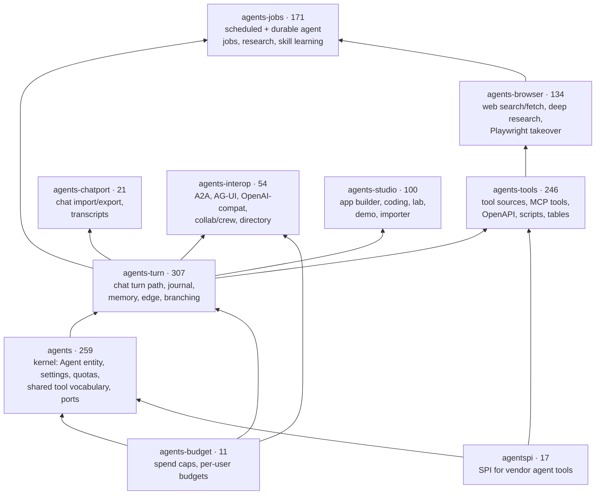

# Agents decomposition: module map

`core/agents` was the reactor's largest module — 1,165 main source files at the
start of the split — and is now a kernel plus nine satellite modules. The cap is
300 main files per module (`scripts/ci/check-module-size.sh`, baseline
`scripts/ci/module-size-baseline.txt`); at v0.1.9 `agents-turn` has grown past it
(307 files) and every other module is under it. The decision record is
[ADR-0023](../ADR-0023-agents-module-decomposition.md); this page is the map.
File counts are from the generated
[core module graph](../core-module-graph.md).

Dependents sit above their dependencies; an arrow points from a module to one that
depends on it. Only main-scope edges inside the family are drawn (every satellite
also depends on the kernel directly); the full list is in the
[core module graph](../core-module-graph.md). Two points differ from the original
plan in ADR-0023: `agents-budget` and `agentspi` ended up **below** the kernel
(budgets are a lower layer the turn path calls; `agentspi` is the SPI vendor
modules implement), and the tools edge is `agents-tools → agents-turn`, not the
reverse — the turn path only ever reached tools through the kernel port
`tools.AgentToolPort`, while nine tool classes referenced turn classes.

## What lives where

| Module | Packages (under `com.agenticai.core`) | Contents |
|---|---|---|
| `agents` (kernel) | `agents.core`, `agents.turn` (`TurnContext`), `agents.modality`, `agents.hosted`, `agents.quota`, `agents.guardrail`, `agents.runbudget`, `agents.dto`, `agents.version`, `agents.capability`, `agents.toolpolicy`, `agents.trust`, `agents.attestation`, `agents.consent`, shared `agents.tools`/`agents.job`/`agents.a2a`/`agents.collab`/`agents.crew` vocabulary and ports | The `Agent` entity and its value objects, `AgentService` and collaborators, hosted-pool client, quota/guardrail controllers, the ports satellites implement. The `agents` root package is empty. |
| `agents-turn` | `agents.turn`, `agents.turn.quality`, `agents.turn.cache`, `agents.edge`, `agents.usermemory`, `agents.memory`, `agents.context`, `agents.hooks`, `agents.turnjournal`, `agents.resumable`, `agents.branching`, `agents.decision`, `agents.gateway`, `agents.assist`, `agents.skills`, `agents.experiment`, `agents.vision`, `agents.loadtest`, `agents.share`, `agents.promptdirectives`, `agents.collab`, `agents.crew` | The hot path: `AgentChatService`, `ChatTurnExecutor`, `AgentChatStreamController`, `TenantScopedFlux`, attachments, RL arms, failover chain, the turn journal, the conversation tree (`agents.branching`, including `ChatThreadController` and `ChatThreadService` behind `/api/chat/threads`, v0.1.9). |
| `agents-tools` | `agents.tools.*` (minus the kernel's shared vocabulary and the browser/web packages), `tables` | `ToolSource`/`ToolResolver`, the built-in tool families, MCP tool wiring, OpenAPI tools, script/code tools, scheduling. |
| `agents-browser` | `agents.tools.browseruse`, `agents.tools.web` | Web search providers, page fetch, deep research, Playwright browser takeover; the HTTP request pipeline (`HttpRequestExecutor` + stage classes). |
| `agents-jobs` | `agents.job.*`, `agents.scheduledtask`, `agents.research`, `agents.learning`, `agents.skills.learning` | Scheduled and durable agent jobs, research runs, skill learning, progress/ownership, operator endpoints. |
| `agents-chatport` | `agents.chatport` | Chat import, export and transcripts ([details](chatport.md)). |
| `agents-interop` | `agents.a2a`, `agents.agui`, `agents.openai`, `agents.directory` | A2A server surface, AG-UI, the OpenAI-compatible endpoints, the agent directory. |
| `agents-studio` | `agents.appbuilder`, `agents.coding`, `agents.importer`, `agents.demo`, `agents.lab`, `agents.ragquality`, `agents.face`, `tutor` | App builder, coding harness, platform importer, demo studio, agent lab, the tutor. |
| `agents-budget` | `agents.budget`, `agents.spendcap` | Per-user budgets and spend caps — a layer **below** the kernel ([details](budgets.md)). |
| `agentspi` | `agentspi` | The service-provider interface vendor modules implement; vendor code sits in `google`, `payments`, `sarvam`, `imagegen`, `elevenlabs` behind this SPI ([ADR-0011](../ADR-0011-provider-plugins.md)). |

## The pattern

The split uses **ports and adapters** with the kernel as the port owner. When
kernel code needed something that moved out, the kernel kept an interface —
`tools.AgentToolPort` (implemented by `AgentToolProvider` in `agents-tools`),
`tools.WebToolPort` / `tools.BrowserToolPort` (`agents-browser`),
`job.AgentJobLookup` / `job.progress.JobProgressRecorder` /
`tools.scheduling.ScheduleTaskToolFactory` (`agents-jobs`),
`A2aRemoteAgentToolSource` / `CollaboratorToolFactory` /
`SpecialistHandoffService` (`agents-interop`), `tools.coding.CodingTaskToolFactory`
(`agents-studio`) — and the satellite provides the implementation. Classes that
both sides need (entities, value objects, step events, the tool-call log) stayed
in the kernel as shared vocabulary.

Two rules keep the boundary from eroding:

- **Direction:** satellites depend on the kernel, never the reverse. Maven
  enforces it at compile time — a module cycle cannot be committed, unlike the
  package cycles inside one module that the ArchUnit store could only freeze.
- **Size:** 300 main files per module, empty `agents` root package, ratcheted
  by `ModuleBoundaryRulesTest`; the baseline only shrinks.

Package names were deliberately **not** changed on the first move: split
packages across jars are legal on the plain classpath Spring Boot uses, so no
import, bean name, JPA entity name, REST path or ArchUnit "area" moved. Renaming
packages is a separate mechanical step (ADR-0023 step 7, still open).

## Per-cut records

- [Budgets and spend caps → `agents-budget`](budgets.md)
- [Chat import/export → `agents-chatport`](chatport.md)
- The remaining cuts (`agents-jobs`, `agents-browser`, `agents-interop`,
  `agents-studio`, `agents-tools`, `agents-turn`, the emptied root package) are
  recorded step by step in [ADR-0023 sections 4–5](../ADR-0023-agents-module-decomposition.md).
