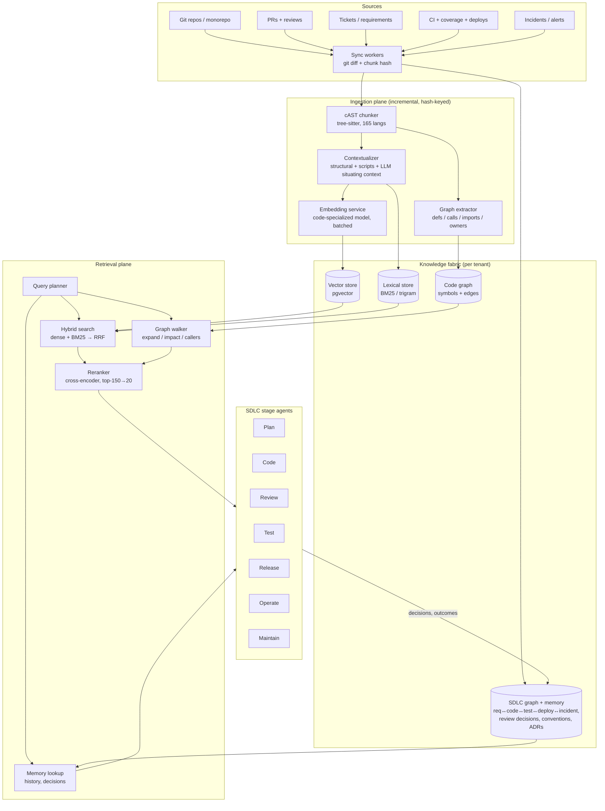

# Code Intelligence Fabric: Solving the SDLC with Codebase RAG

**A world-class design synthesized from the 2026 state of the art**
*Prepared for the agentic-ai-platform · July 2026*

---

## 1. Executive summary

The industry has just lived through a correction. Between 2023 and 2025 everyone
indexed everything; in 2025–2026 leading products publicly walked parts of that
back — Claude Code ships with **no index at all** (pure agentic grep/read), and
Qodo, after building a state-of-the-art RAG system for code review, **removed
most of it** because frontier models now fetch repo context themselves via
git/grep tools, leaving the index layer's ROI "right around zero" for that use
case. Meanwhile Cursor still indexes every codebase with Merkle-tree
incremental sync because millisecond retrieval UX demands it, Qodo still runs
RAG across 10,000-repo estates because no agent can grep an estate, and
graph-augmented retrieval posts ~33% improvements on SWE-bench-style
localization.

The synthesis — and the core thesis of this design — is:

> **Index what agents cannot rediscover; let agents retrieve what they can.
> Wrap both behind one retrieval plane, and link it to every SDLC artifact —
> not just code.**

What agents *can* rediscover by themselves (given tools): the current contents
of one repo. What they *cannot*: cross-repo/estate-wide semantics, the code
graph's multi-hop structure at interactive latency, **history** (why code is
the way it is, past review decisions, conventions), **intent** (requirements,
contracts, compliance constraints), and **operational linkage** (which deploy
broke what, who owns which service). That irreplaceable knowledge is exactly
what the SDLC runs on. So the world-class solution is not "a vector DB of
code chunks"; it is a **Code Intelligence Fabric**: four complementary stores
(vector, lexical, code graph, SDLC knowledge graph + memory) behind one
query-planning retrieval API, kept fresh by the incremental ingestion pipeline
we already built (`tools/codebase-rag`), and consumed by stage-specific agents
across Plan → Code → Review → Test → Release → Operate → Maintain.

Quality is engineered, not hoped for: cAST-style AST chunking (+4.3 Recall@5,
+2.67 SWE-bench Pass@1 over line chunking), Anthropic contextual retrieval
(35% failure reduction from contextual embeddings alone; 49% with contextual
BM25; **67% with reranking**, at ~$1.02 per million tokens one-time with
prompt caching), hybrid dense+lexical fusion, and a permanent retrieval eval
harness that gates every pipeline change.

---

## 2. What the internet says (research findings)

### 2.1 The pendulum: RAG → agentic search → hybrid

| Signal | Evidence | Implication |
|---|---|---|
| Claude Code uses **no index** — agentic grep/glob/read | Widely analyzed through 2025–26 | For *single-repo, interactive* agents, models self-retrieve well; indexes are optional there |
| Qodo **removed** most of its code-review RAG in v2.4 | Their own postmortem: index lift ≈ maintenance cost | Don't index what an agent can rediscover from the working tree |
| Qodo **kept** retrieval for PR history, review decisions, conventions | Same postmortem: "retrieval for the irretrievable" | History/intent/memory must be indexed — agents cannot grep the past |
| Cursor **still indexes everything**, Merkle-tree incremental sync every ~10 min, obfuscated paths, embeddings-only server side | Cursor engineering blog | Latency-critical UX and IDE-scale retrieval still need an index; incremental sync is table stakes |
| Qodo's 10k-repo RAG: AST chunking + LLM chunk descriptions + two-stage retrieval (vector → LLM filter/rank) + golden-repo filtering | Qodo engineering blog | At estate scale, RAG is not optional; naive cosine similarity is insufficient |
| Grep-only retrieval criticized for burning tokens/latency on large repos | Milvus and others, 2026 | Agentic search alone doesn't scale economically either — hybrid wins |

### 2.2 Retrieval quality: what measurably works

- **AST chunking (cAST, EMNLP 2025):** recursive split-then-merge over the
  syntax tree so every chunk is a self-contained semantic unit. +4.3 Recall@5
  (RepoEval), +2.67 Pass@1 (SWE-bench) vs line-based chunking. Our
  `codebase-rag` chunker already implements this shape (tree-sitter, ~165
  languages, split oversized, merge small).
- **Contextual retrieval (Anthropic):** prepend a 50–100-token LLM-written
  situating context to each chunk before embedding + BM25. Failure-rate
  reductions: 35% (contextual embeddings), 49% (+ contextual BM25), **67%
  (+ reranking)**. One-time cost ≈ $1.02/M document tokens with prompt
  caching. Retrieve ~150 candidates → rerank → top-20.
- **Hybrid dense + lexical:** code queries are bimodal — identifiers demand
  exact match (BM25/trigram), concepts demand semantics (dense). Every
  production system (Cursor, Qodo, Sourcegraph, CodeRAG-style OSS) fuses both.
- **Code embeddings:** code-specialized models (voyage-code-3,
  CodeRankEmbed-class, Jina-code) outperform general text embeddings on CoIR;
  quantized/Matryoshka variants cut vector storage 3–8× — relevant at estate
  scale.
- **Graph-augmented retrieval:** AST-derived code graphs (calls, imports,
  inheritance, ownership) enable multi-hop localization that embeddings miss;
  graph-based approaches report ~32.8% improvement on SWE-bench localization.
  Crucially, **AST-derived graphs beat LLM-extracted knowledge graphs** on
  reliability — deterministic extraction wins for code structure.
- **Where GraphRAG breaks** (and what fixes it): hidden connections (events,
  configs, generated contracts), missing intent (the "why"), no change
  verification. The fix is a layer above the graph: link code to
  **requirements, contracts, and decisions** — i.e., an SDLC knowledge graph.

### 2.3 The SDLC angle

The 2026 enterprise pattern (SDLC AI Radar, enterprise-knowledge-graph
writing) is converging on one graph linking Requirements → Stories → Code →
Tests → Deployments → Incidents → Owners, so agents at each stage query
cause-and-effect ("which code implements this requirement, is it tested,
when did it last deploy, what broke"). Point tools (Greptile/CodeRabbit for
review, Copilot for authoring) each rebuild fragments of this context; the
durable advantage is owning the **fabric** they all read from.

---

## 3. Design principles

1. **Index the irretrievable.** Vector-index code for scale/latency paths;
   *always* index history, decisions, conventions, and cross-artifact links —
   no agent can rediscover those from a checkout.
2. **Agentic on top, indexed underneath.** Agents choose tools (grep-like
   exact search, semantic search, graph walk, history lookup) via one
   retrieval API. The planner — not dogma — decides which store serves a query.
3. **Deterministic structure, probabilistic meaning.** AST/deterministic
   extraction builds the code graph; LLMs add situating context and summaries.
   Never let an LLM hallucinate an edge that a parser can produce.
4. **Incremental everything.** Content-hash/Merkle-style change detection at
   file and chunk level (already built); every derived artifact (context,
   embedding, graph edges, summaries) is cache-keyed by content hash so
   steady-state cost ≈ diff size, not repo size.
5. **Freshness is a feature.** Index lag is measured in seconds after push,
   not nightly batches. Stale retrieval is worse than no retrieval — it makes
   agents confidently wrong.
6. **Eval-gated pipeline.** A golden query set per repo; retrieval
   Recall@k/MRR tracked per commit of the *pipeline*; no chunker/embedder/
   prompt change ships without beating the harness.
7. **Tenant-safe by construction.** Every store partitioned per tenant
   (schema-per-tenant, as the platform already does); retrieval API enforces
   TenantContext; embeddings and graphs never cross tenants.

---

## 4. Architecture: the Code Intelligence Fabric

### 4.1 Ingestion plane (built — extend)

`tools/codebase-rag` is the seed: git-diff + per-chunk-hash incremental sync,
tree-sitter AST chunking with fallbacks, structural context (path, symbol
chain, imports), pluggable context **scripts**, cached LLM situating
summaries, pluggable embedders. Extensions to world-class:

- **Webhook-driven sync** (push/PR events → queue → workers) targeting
  <60 s index lag; Cursor-style periodic reconcile as backstop.
- **Graph extraction pass** in the same walk: emit
  `(symbol, kind, file, span)` nodes and `(calls, imports, extends,
  implements, references)` edges from the same tree-sitter parse — zero
  extra parsing cost. Store in Postgres adjacency tables (per tenant);
  no graph DB needed until multi-hop latency demands it.
- **Contextual retrieval at scale:** batch the LLM situating pass with
  prompt caching (whole file cached, per-chunk marginal cost tiny —
  Anthropic's measured ~$1.02/M tokens); *only* for new/changed chunks
  (already our behavior).
- **Estate features:** repo registry with tiers ("golden repos" boosted at
  query time, per Qodo's 10k-repo lesson), repo-level routing before chunk
  search, dedup of vendored/generated code by content hash.

### 4.2 Knowledge fabric — four stores, one truth

1. **Vector store** — pgvector (already in the platform). Chunk = code +
   context header; embedding model: code-specialized (e.g. voyage-code-3
   class; self-hosted fallback via fastembed/ST for BYOK tenants). HNSW
   index per tenant schema; int8/Matryoshka quantization at scale.
2. **Lexical store** — Postgres FTS + pg_trgm (identifiers, error strings,
   exact symbol match). BM25 over the *contextualized* chunk (contextual
   BM25). This is the cheap half of hybrid and catches what embeddings miss.
3. **Code graph** — deterministic, AST-derived: symbols, files, calls,
   imports, inheritance, plus CODEOWNERS/blame-derived ownership. Powers:
   "callers of X", "blast radius of changing Y", test↔code mapping.
4. **SDLC knowledge graph + memory** — the layer that makes this an *SDLC*
   solution, not a code-search feature:
   - Entities: Requirement/Story, ADR, Service, CodeArtifact(symbol/file),
     TestCase, PR, ReviewDecision, Deployment, Incident, Team/Owner, Policy.
   - Edges: `implements`, `validates`, `deployed_in`, `caused_by?`,
     `owned_by`, `decided_in`, `supersedes`.
   - Memory: review decisions ("we rejected this pattern in PR #812 because…"),
     conventions, migration status — exactly the "irretrievable" knowledge
     Qodo kept when it deleted the rest of its index.

### 4.3 Retrieval plane

- **Query planner** classifies intent (identifier lookup / conceptual /
  structural / historical / cross-artifact) and fans out to the right stores.
- **Hybrid fusion:** dense top-k + BM25 top-k → Reciprocal Rank Fusion.
- **Rerank:** cross-encoder over ~150 candidates → top-20 (the configuration
  Anthropic measured at 67% failure reduction).
- **Graph expansion:** each hit optionally expands one hop (enclosing class,
  direct callers/callees, linked tests) — small token cost, large groundedness
  gain for repo-level tasks (the ~33% SWE-bench-style localization lift).
- **Exposed as agent tools**, not one monolithic "search":
  `search_code`, `find_symbol`, `callers_of`, `impact_of`, `tests_for`,
  `history_of`, `decisions_about`, `trace_requirement`. Agents compose them —
  agentic retrieval on top, indexes underneath.
- **Freshness contract:** responses carry `indexed_commit`; agents can demand
  `at_head=true` to force a sync-then-search for correctness-critical flows
  (review, release).

---

## 5. Solving each SDLC stage

| Stage | Pain today | Fabric-powered capability | Primary stores |
|---|---|---|---|
| **Plan** | Estimates and impact are guesswork | `trace_requirement` + `impact_of`: from a story, find prior art, affected services, owners, blast radius, similar past efforts and their actual cost | KG + code graph |
| **Code** | Agents/devs lack cross-repo context | Context injection: relevant internal APIs, golden-repo exemplars, conventions memory; IDE/agent gets top-20 reranked chunks in <300 ms | Vector + lexical + memory |
| **Review** | Reviews see the diff, not the system | Diff-scoped retrieval: for each hunk — callers, contracts, similar past PRs, *prior review decisions*, violated conventions; comments cite fabric evidence | Code graph + memory + vector |
| **Test** | Coverage gaps invisible; tests duplicate | `tests_for` mapping + coverage ingestion: generate tests only for uncovered changed symbols, in the repo's own test idiom (retrieved exemplars) | Code graph + CI links |
| **Release** | Release notes and risk are manual | Deploy diff → touched symbols → linked stories/incidents → generated notes + risk score (blast radius × ownership × incident history) | KG + code graph |
| **Operate** | Incident → code takes hours | Stack trace/alert → symbol resolution → recent deploys touching that path → owning team → similar past incidents and their fixes | KG + code graph + memory |
| **Maintain** | Tech debt and migrations stall | Estate queries: "all usages of deprecated API X across 400 repos", migration progress as a live graph query; onboarding wiki auto-generated per service from summaries | Vector + graph, estate-scale |

Each stage agent **writes back** (decisions, outcomes, links), so the fabric
compounds: review decisions become future review context; incident RCAs
become future operate context. This closed loop is the moat — none of the
point tools own it.

---

## 6. Quality, evaluation, and operations

- **Golden query harness per repo:** 50–200 (query → expected files/symbols)
  pairs, seeded from merged-PR history (a PR's touched files are ground truth
  for its title/description as query — free labels). Metrics: Recall@5/@20,
  MRR, index lag p95, retrieval latency p95.
- **Gate:** any change to chunker/context/embedder/reranker must not regress
  the harness (CI job, ~minutes, runs on the pipeline's own repo corpus).
- **Targets** (from measured literature): ≥95% Recall@20 on golden sets
  (contextual + hybrid + rerank); index lag < 60 s post-push; search p95
  < 300 ms intra-repo, < 1.5 s estate-wide with rerank.
- **Cost controls:** contextualization only on changed chunks (built);
  prompt caching for the situating pass; quantized embeddings at estate
  scale; per-tenant budgets and metering (the platform's existing
  TenantLimits pattern extends naturally).
- **Security/tenancy:** per-tenant schemas for all four stores (platform
  already does this for `knowledge_chunks`); TenantContext enforced at the
  retrieval API (the filter hardened earlier this week); optional
  Cursor-style path obfuscation + no-plaintext-retention mode for
  source-sensitive tenants; audit-log every retrieval (existing audit-log
  module).

---

## 7. Mapping to agentic-ai-platform & roadmap

The platform already has: schema-per-tenant Postgres + pgvector, a Python
sidecar (chunk/embed/extract), `KnowledgeIngestionJobRunner`, an `sdlc`
module, Kafka, audit logging, and now `tools/codebase-rag`.

- **Phase 0 (done):** `codebase-rag` standalone — incremental AST-ish
  chunking, contextualization hooks, hash-cached LLM context, local index.
- **Phase 1 — Fabric MVP (2–4 wks):** port `codebase-rag` pipeline into the
  sidecar; add tree-sitter + code-embedding model there; store into per-tenant
  `code_chunks` (pgvector) + Postgres FTS; webhook-driven repo sync service in
  `core/knowledge`; hybrid RRF retrieval endpoint + `search_code` tool
  callback (pattern: existing `KnowledgeSearchToolCallback`).
- **Phase 2 — Structure & quality (3–5 wks):** graph extraction pass →
  `code_symbols`/`code_edges`; reranker in sidecar; contextual-BM25; golden
  query harness + CI gate; `callers_of`/`impact_of`/`tests_for` tools.
- **Phase 3 — SDLC graph (4–6 wks):** entity/edge tables linking tickets
  (existing SDLC module connectors), PRs, deploys (deploy module), incidents;
  review-decision memory writer; `trace_requirement`, `history_of`,
  `decisions_about` tools.
- **Phase 4 — Stage agents (ongoing):** wire the seven stage agents onto the
  tool surface (platform's existing agent framework); write-back loops;
  per-stage dashboards (index lag, retrieval quality, agent outcome metrics).

## 8. Risks & mitigations

- **Index maintenance ROI collapses (the Qodo trap):** we index code for
  *scale and latency paths only*, and continuously measure lift vs the
  agentic-grep baseline in the harness; if a layer's lift ≈ 0, delete it —
  the memory/graph layers are the durable core, not the code vectors.
- **Stale index misleads agents:** freshness contract + `at_head` escape
  hatch + reconcile loop.
- **Embedding model churn:** model identity in every chunk hash (built) makes
  swaps a controlled full re-embed, and the harness quantifies the gain.
- **Graph sprawl/noise:** deterministic AST edges only; LLM-inferred links
  (e.g. event pub/sub) flagged with confidence and never used for destructive
  automation.
- **Cost blowups on monorepos:** changed-chunk-only enrichment (built),
  batch + cache LLM passes, sampling-based summaries for cold long-tail files.

---

## Appendix: key sources

- Qodo — *We built a SOTA RAG system for code review… we took most of it out* (2.4 postmortem)
- Qodo — *RAG for a codebase with 10k repos*
- Cursor — *How Cursor indexes codebases fast* / secure indexing (Merkle trees)
- Anthropic — *Contextual retrieval* (35/49/67% failure reductions, $1.02/M)
- cAST (EMNLP 2025 Findings, arXiv:2506.15655) — AST chunking gains
- ByteBell — *GraphRAG for codebases: what it solves, where it breaks*
- CGM (arXiv:2505.16901) & AST-derived-graph reliability studies — graph lift on SWE-bench
- Nathan Lasnoski — *Enterprise knowledge graph for the SDLC* (agentic-first)
- Modal / CoIR — code embedding model comparisons
- Milvus — *Against grep-only retrieval* (token economics)
