# Core module graph

<!-- GENERATED by core/tools/module-graph/gen_module_graph.py from core/*/pom.xml. Do not hand-edit;
     re-run the script (it also has --check for CI). -->

ADR-0011 phase 0 baseline. Edges are `<dependency>` entries between sibling reactor modules
(`groupId` `com.agenticai`). Test-scope edges are marked `(test)`. Classification follows
ADR-0011 section 2.1 and is mirrored by the ArchUnit rules in
`core/app/src/test/java/com/agenticai/core/archrules/ModuleBoundaryRulesTest.java`.

- Reactor modules: **57**
- Sibling edges (compile/runtime): **474**
- Kernel -> vendor module edges: **0**
- Vendor -> vendor module edges: **0**

## Classification

| Kind | Meaning |
|---|---|
| vendor | Adapter module for one external vendor. Target: a provider starter (ADR-0011 phase 4). |
| kernel (hosts vendor code) | Kernel module that still contains vendor adapters in sub-packages. |
| kernel | Vendor-neutral platform code. Must not import vendor modules. |
| distribution | Composition root / deployable (`@SpringBootApplication`). May depend on anything. |

## Modules

| Module | Kind | Main src files | Depends on (sibling modules) | Notes |
|---|---|---:|---|---|
| admin | kernel | 70 | audit, crypto, json, security |  |
| agents | kernel | 259 | agents-budget, agentspi, approval, audit, chat, codeintel, devices, documentgen, eventbus, graphmemory, guardrails, json, knowledge, mcp, providers, rl, sdlc, secrets, security, sharing, storage, tenancy |  |
| agents-browser | kernel | 134 | agents, agents-tools, audit, devices, json, knowledge, providers, secrets, security, sharing, tenancy |  |
| agents-budget | kernel | 11 | audit, chat, providers, security, tenancy |  |
| agents-chatport | kernel | 21 | agents, agents-turn, audit, json, security, sharing, tenancy |  |
| agents-interop | kernel | 54 | agents, agents-budget, agents-turn, audit, chat, json, providers, security, sharing, tenancy |  |
| agents-jobs | kernel | 171 | agents, agents-browser, agents-turn, approval, audit, chat, eventbus, json, providers, rl, security, sharing, tenancy |  |
| agents-studio | kernel | 100 | agents, agents-tools (test), agents-turn, approval, chat, guardrails, json, knowledge, mcp, providers, rl, sdlc, security, sharing, tenancy |  |
| agents-tools | kernel | 246 | agents, agents-turn, agentspi, approval, audit, chat, codeintel, devices, documentgen, eventbus, graphmemory, guardrails, json, knowledge, mcp, providers, sdlc, secrets, security, sharing, storage, tenancy |  |
| agents-turn | kernel | 307 | agents, agents-budget, approval, audit, chat, eventbus, graphmemory, guardrails, json, knowledge, providers, rl, security, sharing, storage, tenancy |  |
| agentspi | kernel | 17 | security |  |
| app | distribution | 196 | admin, agents, agents-browser, agents-budget, agents-chatport, agents-interop, agents-jobs, agents-studio, agents-tools, agents-turn, app-config, approval, audit, billing, brief, chat, crypto, crypto-kms, devices, documentgen, **elevenlabs**, eventbus, **google**, guardrails, **imagegen**, json, knowledge, mcp, mcpserver, omnichannel, omnichannel-social, **payments**, platform, providers, quality, rl, **sarvam**, sdlc, secrets, security, sharing, storage, templates, tenancy, voice, workflow, workflow-portability |  |
| app-config | kernel | 8 | (none) |  |
| app-jobs | distribution | 1 | admin, agents, agents-browser, agents-budget, agents-interop, agents-jobs, agents-studio, agents-tools, agents-turn, app-config, approval, audit, billing, chat, crypto, crypto-kms, devices, documentgen, **elevenlabs**, eventbus, **google**, guardrails, **imagegen**, json, knowledge, mcp, mcpserver, omnichannel, omnichannel-social, **payments**, platform, providers, quality, rl, **sarvam**, sdlc, secrets, security, sharing, storage, templates, tenancy, voice, workflow, workflow-portability |  |
| app-worker | distribution | 1 | admin, agents, agents-browser, agents-budget, agents-interop, agents-jobs, agents-studio, agents-tools, agents-turn, app-config, approval, audit, billing, chat, crypto, crypto-kms, devices, documentgen, **elevenlabs**, eventbus, **google**, guardrails, **imagegen**, json, knowledge, mcp, mcpserver, omnichannel, omnichannel-social, **payments**, platform, providers, quality, rl, **sarvam**, sdlc, secrets, security, sharing, storage, templates, tenancy, voice, workflow, workflow-portability |  |
| approval | kernel | 24 | audit, eventbus, rl, security, tenancy |  |
| audit | kernel | 37 | json |  |
| billing | kernel (hosts vendor code) | 69 | json, security | Razorpay + PhonePe gateways in billing.gateway |
| brief | kernel | 70 | agents, agents-tools, agents-turn, approval, audit, chat, guardrails, json, knowledge, mcp, omnichannel, providers, quality, secrets, security, tenancy, workflow |  |
| chat | kernel (hosts vendor code) | 164 | audit, json, providers, security, tenancy | 16 LLM *ChatClientFactory classes (closed ProviderName) |
| codeintel | kernel | 20 | approval, json, security |  |
| crypto | kernel | 7 | (none) |  |
| crypto-kms | kernel | 4 | crypto, json, security |  |
| dbauth | kernel | 13 | (none) |  |
| devices | kernel | 50 | security, tenancy |  |
| documentgen | kernel | 29 | eventbus, security, storage, tenancy |  |
| elevenlabs | vendor | 45 | agents (test), agents-studio (test), agentspi, crypto, providers, security, speech, storage, tenancy | ElevenLabs TTS/voice clone/music |
| eventbus | kernel | 23 | audit, crypto, mcp, security, tenancy |  |
| google | vendor | 31 | agents (test), agentspi, crypto, guardrails, security, tenancy | Google Workspace OAuth + tools |
| graphmemory | kernel | 12 | chat, json, tenancy |  |
| guardrails | kernel | 105 | approval, audit, json, tenancy |  |
| imagegen | vendor | 39 | agents (test), agents-studio (test), agentspi, providers, security, storage, tenancy | Image/video generation backends |
| json | kernel | 2 | (none) |  |
| knowledge | kernel (hosts vendor code) | 128 | crypto, json, security, storage, tenancy | embeddings / OCR / sidecar clients |
| mcp | kernel | 92 | crypto, json, secrets, security |  |
| mcpserver | kernel | 44 | agents, agents-interop, agents-turn, audit, chat, json, knowledge, security, tenancy, workflow |  |
| omnichannel | kernel (hosts vendor code) | 310 | agents, agents-turn, approval, audit, chat, crypto, devices, eventbus, guardrails, json, **sarvam** (test), security, speech, tenancy | 11 channel types + Twilio sub-packages (closed ChannelType) |
| omnichannel-social | kernel | 94 | omnichannel |  |
| payments | vendor | 55 | agents (test), agents-tools (test), agentspi, approval, audit, billing, crypto, eventbus, json, security, tenancy | UPI mandate payments |
| platform | kernel | 153 | admin, agents, agents-turn, audit, chat, codeintel, crypto, guardrails, json, providers, security, tenancy, workflow |  |
| providers | kernel (hosts vendor code) | 171 | crypto, json, knowledge, tenancy | kernel provider registry; LLM validators + OpenAI/sidecar modality adapters |
| quality | kernel | 151 | chat, json, providers, reliability, security, sharing, tenancy |  |
| reliability | kernel | 1 | (none) |  |
| rl | kernel | 50 | chat, json, security |  |
| sarvam | vendor | 46 | agents, agentspi, crypto, providers, security, speech, storage, tenancy | Sarvam AI (LLM, STT/TTS, translate) |
| sdlc | kernel | 44 | crypto, security, tenancy |  |
| secrets | kernel | 15 | audit, crypto |  |
| security | kernel | 88 | json |  |
| sharing | kernel | 13 | admin, audit, security |  |
| speech | kernel | 11 | (none) |  |
| storage | kernel | 9 | security |  |
| templates | kernel | 44 | agents, agents-turn, audit, security, tenancy, workflow |  |
| tenancy | kernel | 231 | admin, audit, billing, dbauth, json, security, storage |  |
| voice | kernel | 38 | agents, agents-turn, crypto, **elevenlabs** (test), json, providers, **sarvam** (test), security, speech, storage |  |
| workflow | kernel | 282 | admin, agents, agents-browser, agents-tools, agents-turn, approval, audit, chat, crypto, devices, documentgen, eventbus, **google** (test), json, knowledge, omnichannel, providers, quality, security, sharing, tenancy, voice, workflow-expression |  |
| workflow-expression | kernel | 23 | json |  |
| workflow-portability | kernel | 30 | agents, agents-studio, devices, json, knowledge, omnichannel, security, sharing, workflow, workflow-expression |  |

## Graph

Vendor modules are highlighted; distributions are dashed. Test-scope edges are omitted.

```mermaid
graph LR
  admin[admin]
  agents[agents]
  agents_browser[agents-browser]
  agents_budget[agents-budget]
  agents_chatport[agents-chatport]
  agents_interop[agents-interop]
  agents_jobs[agents-jobs]
  agents_studio[agents-studio]
  agents_tools[agents-tools]
  agents_turn[agents-turn]
  agentspi[agentspi]
  app[app]
  app_config[app-config]
  app_jobs[app-jobs]
  app_worker[app-worker]
  approval[approval]
  audit[audit]
  billing[billing]
  brief[brief]
  chat[chat]
  codeintel[codeintel]
  crypto[crypto]
  crypto_kms[crypto-kms]
  dbauth[dbauth]
  devices[devices]
  documentgen[documentgen]
  elevenlabs[elevenlabs]
  eventbus[eventbus]
  google[google]
  graphmemory[graphmemory]
  guardrails[guardrails]
  imagegen[imagegen]
  json[json]
  knowledge[knowledge]
  mcp[mcp]
  mcpserver[mcpserver]
  omnichannel[omnichannel]
  omnichannel_social[omnichannel-social]
  payments[payments]
  platform[platform]
  providers[providers]
  quality[quality]
  reliability[reliability]
  rl[rl]
  sarvam[sarvam]
  sdlc[sdlc]
  secrets[secrets]
  security[security]
  sharing[sharing]
  speech[speech]
  storage[storage]
  templates[templates]
  tenancy[tenancy]
  voice[voice]
  workflow[workflow]
  workflow_expression[workflow-expression]
  workflow_portability[workflow-portability]
  admin --> audit
  admin --> crypto
  admin --> json
  admin --> security
  agents --> agents_budget
  agents --> agentspi
  agents --> approval
  agents --> audit
  agents --> chat
  agents --> codeintel
  agents --> devices
  agents --> documentgen
  agents --> eventbus
  agents --> graphmemory
  agents --> guardrails
  agents --> json
  agents --> knowledge
  agents --> mcp
  agents --> providers
  agents --> rl
  agents --> sdlc
  agents --> secrets
  agents --> security
  agents --> sharing
  agents --> storage
  agents --> tenancy
  agents_browser --> agents
  agents_browser --> agents_tools
  agents_browser --> audit
  agents_browser --> devices
  agents_browser --> json
  agents_browser --> knowledge
  agents_browser --> providers
  agents_browser --> secrets
  agents_browser --> security
  agents_browser --> sharing
  agents_browser --> tenancy
  agents_budget --> audit
  agents_budget --> chat
  agents_budget --> providers
  agents_budget --> security
  agents_budget --> tenancy
  agents_chatport --> agents
  agents_chatport --> agents_turn
  agents_chatport --> audit
  agents_chatport --> json
  agents_chatport --> security
  agents_chatport --> sharing
  agents_chatport --> tenancy
  agents_interop --> agents
  agents_interop --> agents_budget
  agents_interop --> agents_turn
  agents_interop --> audit
  agents_interop --> chat
  agents_interop --> json
  agents_interop --> providers
  agents_interop --> security
  agents_interop --> sharing
  agents_interop --> tenancy
  agents_jobs --> agents
  agents_jobs --> agents_browser
  agents_jobs --> agents_turn
  agents_jobs --> approval
  agents_jobs --> audit
  agents_jobs --> chat
  agents_jobs --> eventbus
  agents_jobs --> json
  agents_jobs --> providers
  agents_jobs --> rl
  agents_jobs --> security
  agents_jobs --> sharing
  agents_jobs --> tenancy
  agents_studio --> agents
  agents_studio --> agents_turn
  agents_studio --> approval
  agents_studio --> chat
  agents_studio --> guardrails
  agents_studio --> json
  agents_studio --> knowledge
  agents_studio --> mcp
  agents_studio --> providers
  agents_studio --> rl
  agents_studio --> sdlc
  agents_studio --> security
  agents_studio --> sharing
  agents_studio --> tenancy
  agents_tools --> agents
  agents_tools --> agents_turn
  agents_tools --> agentspi
  agents_tools --> approval
  agents_tools --> audit
  agents_tools --> chat
  agents_tools --> codeintel
  agents_tools --> devices
  agents_tools --> documentgen
  agents_tools --> eventbus
  agents_tools --> graphmemory
  agents_tools --> guardrails
  agents_tools --> json
  agents_tools --> knowledge
  agents_tools --> mcp
  agents_tools --> providers
  agents_tools --> sdlc
  agents_tools --> secrets
  agents_tools --> security
  agents_tools --> sharing
  agents_tools --> storage
  agents_tools --> tenancy
  agents_turn --> agents
  agents_turn --> agents_budget
  agents_turn --> approval
  agents_turn --> audit
  agents_turn --> chat
  agents_turn --> eventbus
  agents_turn --> graphmemory
  agents_turn --> guardrails
  agents_turn --> json
  agents_turn --> knowledge
  agents_turn --> providers
  agents_turn --> rl
  agents_turn --> security
  agents_turn --> sharing
  agents_turn --> storage
  agents_turn --> tenancy
  agentspi --> security
  app --> admin
  app --> agents
  app --> agents_browser
  app --> agents_budget
  app --> agents_chatport
  app --> agents_interop
  app --> agents_jobs
  app --> agents_studio
  app --> agents_tools
  app --> agents_turn
  app --> app_config
  app --> approval
  app --> audit
  app --> billing
  app --> brief
  app --> chat
  app --> crypto
  app --> crypto_kms
  app --> devices
  app --> documentgen
  app --> elevenlabs
  app --> eventbus
  app --> google
  app --> guardrails
  app --> imagegen
  app --> json
  app --> knowledge
  app --> mcp
  app --> mcpserver
  app --> omnichannel
  app --> omnichannel_social
  app --> payments
  app --> platform
  app --> providers
  app --> quality
  app --> rl
  app --> sarvam
  app --> sdlc
  app --> secrets
  app --> security
  app --> sharing
  app --> storage
  app --> templates
  app --> tenancy
  app --> voice
  app --> workflow
  app --> workflow_portability
  app_jobs --> admin
  app_jobs --> agents
  app_jobs --> agents_browser
  app_jobs --> agents_budget
  app_jobs --> agents_interop
  app_jobs --> agents_jobs
  app_jobs --> agents_studio
  app_jobs --> agents_tools
  app_jobs --> agents_turn
  app_jobs --> app_config
  app_jobs --> approval
  app_jobs --> audit
  app_jobs --> billing
  app_jobs --> chat
  app_jobs --> crypto
  app_jobs --> crypto_kms
  app_jobs --> devices
  app_jobs --> documentgen
  app_jobs --> elevenlabs
  app_jobs --> eventbus
  app_jobs --> google
  app_jobs --> guardrails
  app_jobs --> imagegen
  app_jobs --> json
  app_jobs --> knowledge
  app_jobs --> mcp
  app_jobs --> mcpserver
  app_jobs --> omnichannel
  app_jobs --> omnichannel_social
  app_jobs --> payments
  app_jobs --> platform
  app_jobs --> providers
  app_jobs --> quality
  app_jobs --> rl
  app_jobs --> sarvam
  app_jobs --> sdlc
  app_jobs --> secrets
  app_jobs --> security
  app_jobs --> sharing
  app_jobs --> storage
  app_jobs --> templates
  app_jobs --> tenancy
  app_jobs --> voice
  app_jobs --> workflow
  app_jobs --> workflow_portability
  app_worker --> admin
  app_worker --> agents
  app_worker --> agents_browser
  app_worker --> agents_budget
  app_worker --> agents_interop
  app_worker --> agents_jobs
  app_worker --> agents_studio
  app_worker --> agents_tools
  app_worker --> agents_turn
  app_worker --> app_config
  app_worker --> approval
  app_worker --> audit
  app_worker --> billing
  app_worker --> chat
  app_worker --> crypto
  app_worker --> crypto_kms
  app_worker --> devices
  app_worker --> documentgen
  app_worker --> elevenlabs
  app_worker --> eventbus
  app_worker --> google
  app_worker --> guardrails
  app_worker --> imagegen
  app_worker --> json
  app_worker --> knowledge
  app_worker --> mcp
  app_worker --> mcpserver
  app_worker --> omnichannel
  app_worker --> omnichannel_social
  app_worker --> payments
  app_worker --> platform
  app_worker --> providers
  app_worker --> quality
  app_worker --> rl
  app_worker --> sarvam
  app_worker --> sdlc
  app_worker --> secrets
  app_worker --> security
  app_worker --> sharing
  app_worker --> storage
  app_worker --> templates
  app_worker --> tenancy
  app_worker --> voice
  app_worker --> workflow
  app_worker --> workflow_portability
  approval --> audit
  approval --> eventbus
  approval --> rl
  approval --> security
  approval --> tenancy
  audit --> json
  billing --> json
  billing --> security
  brief --> agents
  brief --> agents_tools
  brief --> agents_turn
  brief --> approval
  brief --> audit
  brief --> chat
  brief --> guardrails
  brief --> json
  brief --> knowledge
  brief --> mcp
  brief --> omnichannel
  brief --> providers
  brief --> quality
  brief --> secrets
  brief --> security
  brief --> tenancy
  brief --> workflow
  chat --> audit
  chat --> json
  chat --> providers
  chat --> security
  chat --> tenancy
  codeintel --> approval
  codeintel --> json
  codeintel --> security
  crypto_kms --> crypto
  crypto_kms --> json
  crypto_kms --> security
  devices --> security
  devices --> tenancy
  documentgen --> eventbus
  documentgen --> security
  documentgen --> storage
  documentgen --> tenancy
  elevenlabs --> agentspi
  elevenlabs --> crypto
  elevenlabs --> providers
  elevenlabs --> security
  elevenlabs --> speech
  elevenlabs --> storage
  elevenlabs --> tenancy
  eventbus --> audit
  eventbus --> crypto
  eventbus --> mcp
  eventbus --> security
  eventbus --> tenancy
  google --> agentspi
  google --> crypto
  google --> guardrails
  google --> security
  google --> tenancy
  graphmemory --> chat
  graphmemory --> json
  graphmemory --> tenancy
  guardrails --> approval
  guardrails --> audit
  guardrails --> json
  guardrails --> tenancy
  imagegen --> agentspi
  imagegen --> providers
  imagegen --> security
  imagegen --> storage
  imagegen --> tenancy
  knowledge --> crypto
  knowledge --> json
  knowledge --> security
  knowledge --> storage
  knowledge --> tenancy
  mcp --> crypto
  mcp --> json
  mcp --> secrets
  mcp --> security
  mcpserver --> agents
  mcpserver --> agents_interop
  mcpserver --> agents_turn
  mcpserver --> audit
  mcpserver --> chat
  mcpserver --> json
  mcpserver --> knowledge
  mcpserver --> security
  mcpserver --> tenancy
  mcpserver --> workflow
  omnichannel --> agents
  omnichannel --> agents_turn
  omnichannel --> approval
  omnichannel --> audit
  omnichannel --> chat
  omnichannel --> crypto
  omnichannel --> devices
  omnichannel --> eventbus
  omnichannel --> guardrails
  omnichannel --> json
  omnichannel --> security
  omnichannel --> speech
  omnichannel --> tenancy
  omnichannel_social --> omnichannel
  payments --> agentspi
  payments --> approval
  payments --> audit
  payments --> billing
  payments --> crypto
  payments --> eventbus
  payments --> json
  payments --> security
  payments --> tenancy
  platform --> admin
  platform --> agents
  platform --> agents_turn
  platform --> audit
  platform --> chat
  platform --> codeintel
  platform --> crypto
  platform --> guardrails
  platform --> json
  platform --> providers
  platform --> security
  platform --> tenancy
  platform --> workflow
  providers --> crypto
  providers --> json
  providers --> knowledge
  providers --> tenancy
  quality --> chat
  quality --> json
  quality --> providers
  quality --> reliability
  quality --> security
  quality --> sharing
  quality --> tenancy
  rl --> chat
  rl --> json
  rl --> security
  sarvam --> agents
  sarvam --> agentspi
  sarvam --> crypto
  sarvam --> providers
  sarvam --> security
  sarvam --> speech
  sarvam --> storage
  sarvam --> tenancy
  sdlc --> crypto
  sdlc --> security
  sdlc --> tenancy
  secrets --> audit
  secrets --> crypto
  security --> json
  sharing --> admin
  sharing --> audit
  sharing --> security
  storage --> security
  templates --> agents
  templates --> agents_turn
  templates --> audit
  templates --> security
  templates --> tenancy
  templates --> workflow
  tenancy --> admin
  tenancy --> audit
  tenancy --> billing
  tenancy --> dbauth
  tenancy --> json
  tenancy --> security
  tenancy --> storage
  voice --> agents
  voice --> agents_turn
  voice --> crypto
  voice --> json
  voice --> providers
  voice --> security
  voice --> speech
  voice --> storage
  workflow --> admin
  workflow --> agents
  workflow --> agents_browser
  workflow --> agents_tools
  workflow --> agents_turn
  workflow --> approval
  workflow --> audit
  workflow --> chat
  workflow --> crypto
  workflow --> devices
  workflow --> documentgen
  workflow --> eventbus
  workflow --> json
  workflow --> knowledge
  workflow --> omnichannel
  workflow --> providers
  workflow --> quality
  workflow --> security
  workflow --> sharing
  workflow --> tenancy
  workflow --> voice
  workflow --> workflow_expression
  workflow_expression --> json
  workflow_portability --> agents
  workflow_portability --> agents_studio
  workflow_portability --> devices
  workflow_portability --> json
  workflow_portability --> knowledge
  workflow_portability --> omnichannel
  workflow_portability --> security
  workflow_portability --> sharing
  workflow_portability --> workflow
  workflow_portability --> workflow_expression
  classDef vendor fill:#fde2e1,stroke:#c0392b,color:#000
  classDef mixed fill:#fff4d6,stroke:#b7950b,color:#000
  classDef dist fill:#eef,stroke:#446,stroke-dasharray: 4 3,color:#000
  class app dist
  class app_jobs dist
  class app_worker dist
  class billing mixed
  class chat mixed
  class elevenlabs vendor
  class google vendor
  class imagegen vendor
  class knowledge mixed
  class omnichannel mixed
  class payments vendor
  class providers mixed
  class sarvam vendor
```

## Who depends on each vendor module

| Vendor module | Depended on by |
|---|---|
| elevenlabs | app, app-jobs, app-worker |
| google | app, app-jobs, app-worker |
| imagegen | app, app-jobs, app-worker |
| payments | app, app-jobs, app-worker |
| sarvam | app, app-jobs, app-worker |
