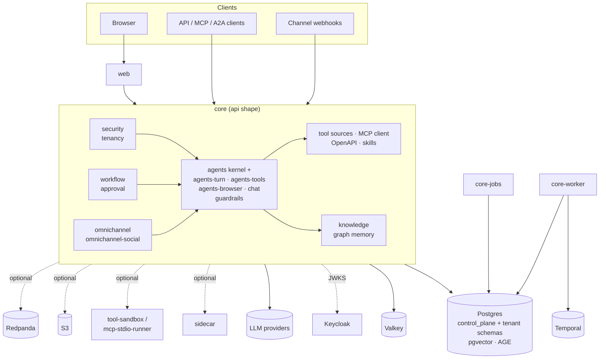
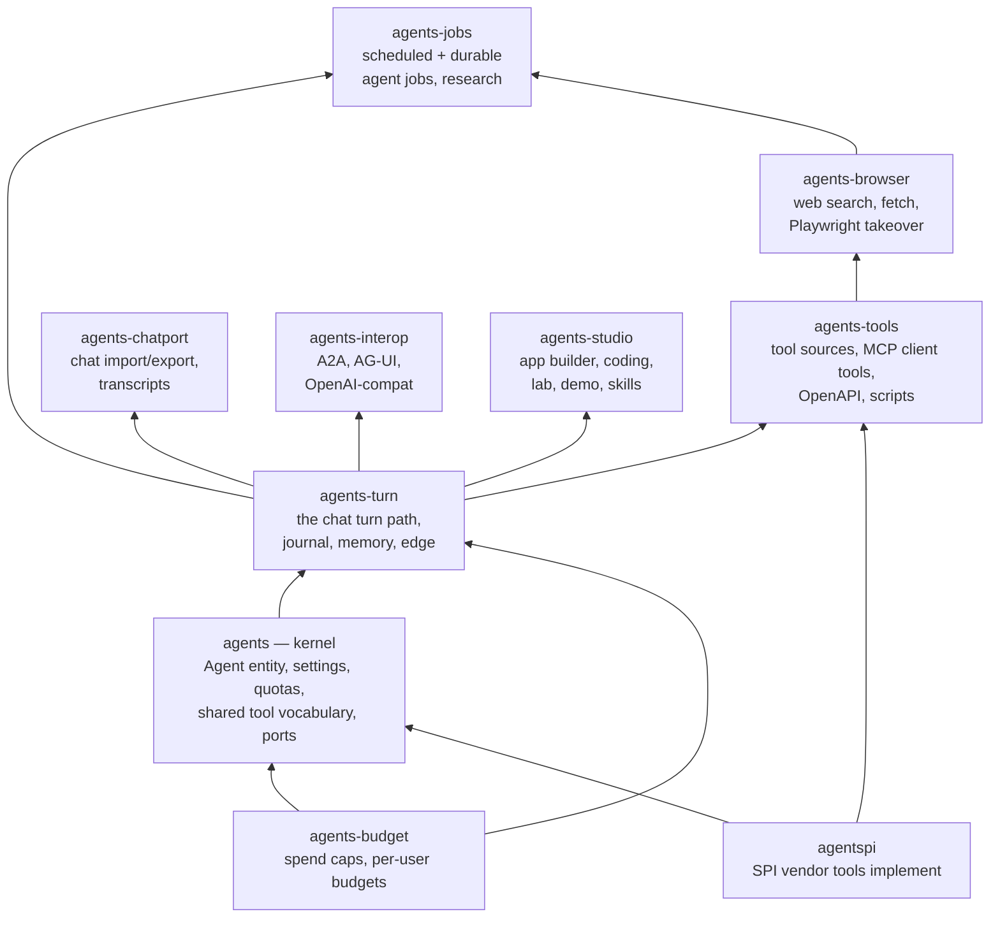

# Architecture overview

VegaDūta is a **modular monolith with satellite services**. The core is one
Spring Boot codebase (a Maven reactor of feature modules) that runs as one
process per shape. Separate services exist only where a separate process pays
for itself.

## Deployables

### Core: one image, four shapes

`core/Dockerfile` builds the reactor; the `MODULE` build argument selects the
executable module. Every shape shares the same modules, configuration
(`core/app-config`) and database.

| Shape | Module | Image | What it does | Replicas |
|---|---|---|---|---|
| **api** | `core/app` (`CoreApplication`) | `core` | REST and SSE API, MCP server (`/mcp`), A2A and AG-UI endpoints, channel webhooks, WebSocket voice relay; the chat path | 1..N |
| **jobs** | `core/app-jobs` (`JobsApplication`) | `core-jobs` | scheduled sweeps and pollers (profile `shape-jobs`), so background work does not compete with chat for the API's threads and connections. The Helm chart can split parts of it into pools (ingest, webhooks, intake, billing) that run from the same image; see [Deployment shapes](../deploy/DEPLOYMENT-SHAPES.md) | exactly 1 per pool |
| **worker** | `core/app-worker` (`WorkerApplication`) | `core-worker` | Temporal workflow worker; only when the Temporal engine is enabled | 0..N |
| **migrate** | `core/app` with `app.tenancy.migrate-only=true` | `core` | Flyway for the control plane and every tenant schema, then exit (`TenantMigrateOnlyRunner`) | one-shot |

Lite runs only the api shape, which then also migrates on boot and runs the
scheduled work itself. Helm runs migrate as a pre-upgrade Job and sets
`app.tenancy.migrate-on-boot=false` on the API.

`APP_ENCRYPTION_KEY` must be the same for every shape: they all read and write
the same encrypted columns.

### Consoles

| | Stack | Purpose |
|---|---|---|
| `web/` | Next.js, React 19 | one application: the tenant console (agents, tools, knowledge, workflows, channels, Cost & ROI, privacy and settings), the signed-out public pages, and the platform-admin console under `/platform-admin` (merged from the former `web-admin/`) |

The console is a client of the core API and authenticates against Keycloak in
the browser (local sign-in in personal mode). Its navigation is assembled in
`web/app/components/nav/navSections.ts` from two halves, `navSectionsAuthor.ts` and
`navSectionsOperate.ts`.

### Optional services

| Service | Runtime | Why it is a separate process |
|---|---|---|
| `services/sidecar` | Python (FastAPI) | ML runtime: document extraction/OCR, embeddings, reranking, Whisper transcription, TTS. Optional for embeddings when an OpenAI-compatible embeddings endpoint is configured. |
| `services/tool-sandbox` | JVM + Python | runs tenant-written code tools; isolation from core |
| `services/mcp-stdio-runner` | Node | runs stdio MCP servers outside core, with a seccomp profile; isolation |
| `services/code-intel` | Python | repository indexing and code search; heavy, async, own runtime |
| `services/app-builder` | Python | generates and builds apps; async, own runtime |
| `services/voice-agent` | Python (LiveKit Agents) | real-time voice sessions; media runtime |
| `services/rl-trainer` | Python | offline training for the contextual-bandit tool/model selection in `core/rl` |
| `services/piece-host` | Node | stdio MCP server that exposes allow-listed Activepieces pieces as tools, run inside the sandboxed `mcp-stdio-runner`; preview, off by default (opt-in Compose overlay `docker-compose.piece-host.yml`) |
| `services/whatsapp-qr` | Node | WhatsApp linked-device bridge (multi-device protocol): links a tenant's own number as a companion device; dials out only, publishes no port |
| `services/workspace-runner` | Node | runs the Assistant's `local_shell` commands for personal installs, with only the projects folder mounted; isolates untrusted command execution from core |
| `services/browser-runner` | Node (Playwright) | the browser behind the personal install's browser add-on (`deploy/compose/browser.yml`); core drives it over `APP_BROWSERUSE_REMOTE_URL` with the same `browser_*` tools as an in-core Chromium; isolates untrusted web content |
| `services/desktop-agent` | Node | loopback computer-use helper for personal installs (screenshots, accessibility tree, click/type, notifications, clipboard); runs on the laptop itself, never in a container |

Two further optional pieces are not Java and not in `services/`: an Ollama
server as the zero-cost local model pool (`--local-ai` in Compose, the
`ollama` chart in Helm, [Run free with local models](../local-models.md)), and
the browser itself, which can run a model on-device and, through the
[edge relay](../edge-relay.md), answer a workspace's SMS and WhatsApp messages.

Infrastructure by tier: Postgres, Valkey and Keycloak are always present;
S3-compatible storage (SeaweedFS by default), PgBouncer, Temporal, Redpanda
(Kafka API), LiveKit, Langfuse and the Prometheus/Grafana/Loki stack are
added by the Full tier's profiles or the Helm values. See
[installation.md](../installation.md).



## Data

- **One Postgres database, schema per tenant.** The `control_plane` schema
  holds tenants, plans, platform settings and the model catalog. Each tenant
  gets its own schema; the connection's `search_path` is set per request from
  the tenant context (`core/tenancy/.../SchemaMultiTenantConnectionProvider`).
  Consequences: a pooler in front of Postgres must use **session** pooling,
  and cross-tenant queries are impossible by construction.
- **Migrations**: Flyway, two folders under
  `core/app/src/main/resources/db/migration/`: `controlplane/` (run once) and
  `tenant/` (run for every tenant schema). They share **one version
  namespace**; `scripts/ci/flyway-lint.sh` enforces unique versions and
  forbids editing released migrations.
- **pgvector** stores embeddings for knowledge chunks, memory and the response
  cache (`core/knowledge`).
- **Apache AGE** stores the graph memory (`core/graphmemory`). Both extensions
  are compiled into the `postgres` image (`deploy/postgres/Dockerfile`).
- **Secrets at rest** (provider keys, channel credentials, MCP environment,
  OpenAPI secrets) are AES-256-GCM encrypted with `APP_ENCRYPTION_KEY`
  (`core/crypto`), with envelope encryption support.
- **Files** go to S3-compatible storage, or to a local volume in Lite
  (`core/storage`).
- **Valkey** (Redis protocol) holds rate limits, short-lived caches and
  coordination state, including the edge relay's job queue when that is
  enabled.
- **Chat history.** The conversation tree (`core/agents-turn`, package
  `agents.branching`) stores every message in Postgres for
  `app.chat.branching.retention-days` (30) when `APP_CHAT_BRANCHING_ENABLED` is
  on. The code default is off; `lite.yml`, `docker-compose.yml` and the Helm chart
  (`core.branchingEnabled`) turn it on (since v0.1.8); the `personal` Spring profile
  (`application-personal.yml`, which `deploy/compose/personal.yml` activates) turns
  it on too. Without it, session history
  lives only in Valkey for the 24 h session window. `GET /api/chat/threads`
  (v0.1.9) lists a user's conversations from this tree.

## Authentication and authorization

- Users sign in with **OpenID Connect** against Keycloak (realm `agentic-ai`;
  template in `deploy/keycloak/`). The consoles use the authorization-code
  flow in the browser; core is a JWT resource server.
- **Dual issuer.** Browsers reach Keycloak on a public URL, while core may
  fetch signing keys over an internal address. Core validates the configured
  issuer plus every entry in `KEYCLOAK_ADDITIONAL_ISSUERS`
  (`core/security/.../SecurityConfig.java`). A token whose issuer is in
  neither list is rejected, which shows up as a 401 on every call.
- Roles and fine-grained permissions come from token claims
  (`KeycloakRoleConverter`, `GranularPermissionConverter`); the tenant is
  resolved from the token's tenant attribute.
- Machine clients have three paths. **Tenant API keys** (`vdak_...`, minted
  under `/api/tenant/api-keys`) authenticate through `ApiKeyAuthFilter` into
  the normal permission checks; a key's scopes are a subset of the issuer's own
  permissions. **MCP grant keys** (`vmcp_...`, `McpApiKeyAuthFilter`) are
  confined to the agents, workflows and collections of their grant; an
  optional OAuth 2.1 mode for `/mcp` is off by default
  ([MCP alignment](mcp-spec-alignment.md)). A2A agent cards are signed, and the
  A2A endpoints (JSON-RPC and HTTP+JSON/REST) take the bearer JWT
  ([A2A conformance](a2a-conformance.md)).
- **Authorization** is route rules (`PERM_*` permissions) plus per-resource
  grants (`RUNNER` < `VIEWER` < `EDITOR`); every mutating endpoint must have one
  or a reviewed exception, enforced by a test. See
  [docs/security/authorization.md](../security/authorization.md).
- **Conversation ownership.** Session memory is keyed by
  `sha256(tenant, agent, user, client session id)` and records its first
  writer as owner; transcript, export, rewind and branching only ever reach
  the caller's own conversation. See the handbook's
  [Security Architecture §4.1](../platform-documentation/security/security-architecture.html).

## Outside the platform: the Agent SDKs

`sdk/java/` and `sdk/python-agent/` are libraries for applications that do not
run on this platform. They put the same kinds of controls (tool risk
classification, human approval, budgets, idempotent effects, guardrails,
audit) around an application's own tool calls, in the application's process,
and need no VegaDūta server. They are not clients of the API (the generated
TypeScript and Python clients in `sdk/typescript/` and `sdk/python/` are) and
`core/` does not depend on them today
([ADR-0013](ADR-0013-embeddable-agent-sdk.md), which is still proposed).
See [SDKs and dependencies](../sdk/README.md).

## Why the chat hot path is not split into services

The path of an agent turn is: authenticate, load agent and tenant settings,
guardrails on the input, retrieval, one or more LLM calls interleaved with tool
calls, a check of the finished answer against the output guardrails, persist,
stream. All of it runs in the api process, and that is deliberate.

The output check does not act the same way on every path. At the default `FAST`
reasoning depth the reply streams token by token, so by the time the complete
answer can be checked the client has already read it: the check **detects and
audits only** (`guardrail.output.blocked` in the audit log) and cannot withhold
anything. The buffered depths (`CAREFUL`, `RIGOROUS`, `PLANNED`) hold the answer
until it has been checked, so a violating answer is replaced by a short notice
and what is stored is the replacement. A `FAST` turn is also held and checked
like that when `OUTPUT_GUARDRAILS` is added to `app.chat.parity.fast-buffering-triggers`
(not in the default list, which is `GENERATION_TOOLS,MCP_TOOLS`); on `FAST` only
the pattern-based guardrails run on the output, because the semantic toxicity
check is a blocking model call. See [configuration](../configuration.md) and
`ChatGuardrailGate`.

Why the path stays in one process:

- **Latency adds up per hop.** An in-process call costs nanoseconds; a network
  hop costs from a fraction of a millisecond to tens of milliseconds, and a
  tool-using turn crosses module boundaries many times. Splitting the path
  would add delay to every token-to-first-byte without making anything faster.
- **Failure modes multiply.** Every hop is a new timeout, retry and partial
  failure to handle, in the one path users feel directly.
- **The modules already give the separation.** Feature modules have their own
  packages and dependencies, and CI guards their shared namespaces (bean,
  entity and path collisions). Teams can own modules without owning
  processes.
- **Scaling does not need it.** The api shape scales horizontally; the load
  that behaves differently (scheduled jobs, durable workflows, ML inference,
  untrusted code, media) is exactly what already runs elsewhere.

A capability becomes a separate service when it is asynchronous or
background work, when it runs untrusted code that needs isolation, or when it
needs a different runtime. It does not become one because it is a "domain".
The full target architecture and extraction rules are in
[ADR-0001](../platform-documentation/decisions/adr-0001-modular-monolith.html#target-architecture)
and [ADR-0014](ADR-0014-horizontal-scaling.md).

## The agents module family

`core/agents` used to be a single module of over 1,100 files — too big to
review, too coupled to bound with package rules, and slow to rebuild. It is now
ten Maven modules that still run in the same process ([ADR-0023](ADR-0023-agents-module-decomposition.md),
per-module notes in [agents-decomposition/](agents-decomposition/README.md)):



An arrow points from a module to one that depends on it; every satellite also depends on the kernel directly
(full list in the [core module graph](core-module-graph.md)).

The patterns that make the split work, and why they were chosen:

- **Ports and adapters (hexagonal seam).** When kernel code needs something
  that moved out, the kernel owns an interface — `tools.AgentToolPort`,
  `tools.WebToolPort`, `tools.BrowserToolPort`, `job.AgentJobLookup`,
  `job.progress.JobProgressRecorder` — and the satellite module implements it.
  The dependency edge always points at the kernel; the kernel never reaches
  into a satellite. This is what keeps the split from re-coupling: a new
  satellite-to-kernel call needs no new port, a new kernel-to-satellite call
  does.
- **Dependency direction enforced by the build, not by review.** Inside one
  Maven module, a package cycle is an ArchUnit violation caught after the fact;
  between modules, Maven refuses a cycle at compile time. Splitting turned ~50
  frozen package-cycle violations into edges the build physically cannot
  recreate.
- **Split packages, same process.** Classes moved to a new jar with their
  package names unchanged, so no import, bean name, entity name, REST path or
  ArchUnit "area" changed — the split is invisible to the runtime and to API
  clients. (Split packages are fine on the plain classpath; the platform does
  not use JPMS.)
- **Module-size ratchet.** A CI gate (`scripts/ci/check-module-size.sh`, baseline
  `scripts/ci/module-size-baseline.txt`) caps each module at 300 main files and the
  `agents` root package at zero classes; the baseline only shrinks. At v0.1.9
  `agents-turn` is over the cap (307 files).

Why split into jars rather than leave it one big module: a change in `agents`
used to recompile and retest ~4,000 tests plus every dependent module; the root
package held 154 unrelated classes whose package-private access coupled them;
and "the agents module" was unownable. Why not split into services instead:
every module still ships in the same `app`/`app-jobs`/`app-worker` shapes, so
the chat hot path keeps its in-process calls — a jar boundary adds no network
hop, which is the whole point of the modular monolith.

## Internal seams of the core

Inside the one process, the parts that used to be a single large class are now small collaborators behind an
interface or a registry, so a new variant is a new class rather than an edit to a switch. These are the seams a
contributor meets; each has a step-by-step guide in [Extending](../extending.md).

| Seam | Where | Pattern | Guide |
|---|---|---|---|
| Workflow node execution | `core/workflow`: `NodeHandler`, one handler per node type, looked up by `WorkflowNodeExecutor`; traversal rules shared by the in-process and Temporal engines in `WorkflowTraversalRules` | Strategy registry; functional core | [section 5](../extending.md#5-add-a-workflow-node-type) |
| Tools offered to an agent turn | `core/agents-tools/.../tools`: `ToolSource` beans (33 today, declared in `ToolSourceConfiguration`) merged by `ToolResolver` | Composite | [section 10](../extending.md#10-add-a-tool-source) |
| Outbound HTTP for agents and workflows | `core/agents-browser/.../tools/web`: validate, resolve secrets, host policy, send, redirect, read and redact | Pipeline of stage classes | [section 11](../extending.md#11-change-the-http-request-pipeline) |
| Observing every LLM call | `core/chat`: `LlmMetricsAdvisor` builds an `LlmCallObservation`, `LlmCallSink`s consume it | Observer; a failing sink never reaches the call | [section 12](../extending.md#12-add-an-llm-call-sink) |
| Recording a turn | `core/agents-turn/.../turnjournal`: `TurnJournal` SPI, `TurnRecorder`; off by default (`app.turn-journal.enabled`); when on, written for every reasoning depth (`FastStreamTurn`, `BufferedTurnRunner`) and for delegated or specialist turns (`SubAgentTurn`), including `APPROVAL` events, with the turn id in the `X-Journal-Turn-Id` response header; no retention purge exists, workflow runs are not journaled | Append-only hash-chained log | [section 13](../extending.md#13-record-more-of-a-turn-in-the-turn-journal), [ADR-0020](ADR-0020-turn-journal.md) |
| Console: workflow node forms | `web/app/components/workflow/nodeConfig`: `NODE_FORMS` registry and `SIMPLE_FORMS` descriptors | Registry | [section 5](../extending.md#5-add-a-workflow-node-type) |
| Console: channel inspectors | `web/app/components/channels/adapters`: `CHANNEL_ADAPTERS` | Registry | [section 6](../extending.md#6-add-a-channel) |

None of these adds a network hop: they are in-process interfaces, which is why the hot-path rule above still holds.
The chat path itself (agent turn through guardrails, tools and the model call) is unchanged by them. Two newer
cross-cutting checks keep conventions from drifting: the list-paging and configuration-reference conformance tests
([ADR-0019](ADR-0019-conformance-by-construction.md)) and the frozen architecture baselines
(`StructureRulesTest`, `ModuleBoundaryRulesTest`; see [the structural audit](STRUCTURAL-AUDIT-2026-10-14.md)). The
direction of travel beyond this (replayable turns, capability tokens, a single policy decision point) is in
[Architecture bets](ARCHITECTURE-BETS-2026-10.md); only bets 1, 10 and 13 have any code, and the rest are proposals.

## Error responses

Every error the core API maps goes through an ordered chain of
`@RestControllerAdvice` classes in `core/app/.../common` (which replaced the
former single `GlobalExceptionHandler`): `ClientRequestExceptionHandler`,
`RequestBindingExceptionHandler`, `ResourceStateExceptionHandler`,
`ExecutionPolicyExceptionHandler`, `ServiceCredentialExceptionHandler`,
`UpstreamDependencyExceptionHandler`, and `FallbackExceptionHandler` last with
the catch-alls. Every body they write is built by `ErrorResponseFactory`. The body is an
[RFC 9457](https://www.rfc-editor.org/rfc/rfc9457) Problem Details object,
served as `application/problem+json`, that also carries the members the API
returned before RFC 9457 support, unchanged:

```json
{
  "type": "urn:vegaduta:problem:agent-not-found",
  "title": "Not Found",
  "status": 404,
  "detail": "No agent found with id 7f0c...",
  "instance": "/api/agents/7f0c...",
  "timestamp": "2026-09-29T10:00:00Z",
  "error": "No agent found with id 7f0c...",
  "requestId": "b1c2..."
}
```

- **RFC 9457 members.** `type` is a stable identifier, not a URL to fetch:
  `urn:vegaduta:problem:` plus a slug taken from the platform exception's
  class (`AgentNotFoundException` becomes `agent-not-found`), from the
  handler's `code` when it has one (`VISION_PLAN_LOCKED` becomes
  `vision-plan-locked`), or from the HTTP status for JDK and Spring
  exceptions (`bad-request`, `internal-server-error`), so it never names an
  internal class. `title` is the HTTP reason phrase, `detail` the same text
  as `error`, `instance` the request path without the query string.
- **Legacy members.** `timestamp`, `status` and `error` are always present,
  plus the handler's extras where it had them: `code` (vision 403s), `errors`
  (workflow validation), `upstreamStatus`, `providerMessage` and
  `edgeAiRecoverable` (LLM provider 502), `budget` and `topUp` (per-user
  budget 402), `lockedReason` and `editableUntil` (edit lock 423). Clients
  should keep reading `error` for the message; `type` is the key for
  branching on the kind of error.
- **Correlation.** `requestId` (the `X-Request-Id` value) and `traceId` (when
  tracing is on) are added from the logging MDC, so a user-reported error can
  be found in the logs. The tenant id is not echoed.
- **No leakage.** The catch-all 500 answers with a fixed sentence; stack
  traces, exception class names and raw upstream bodies stay in the log.
- **Rollback.** `app.errors.problem-details.enabled=false` restores the
  legacy-only `application/json` body (see [configuration](../configuration.md#api-error-format)).

Errors written outside Spring MVC do not pass through this handler and still
use a plain `{"error": "..."}` body: the security filters
(`TenantContextFilter`, `AuditingAccessDeniedHandler`,
`McpApiKeyAuthFilter`, `FraudDetectionInterceptor`), and controllers that
return an error map themselves.

## Where to read next

- [configuration.md](../configuration.md): profiles, shapes and settings
- [extending.md](../extending.md): extension points with file paths
- [ARCHITECTURE-BETS-2026-10.md](ARCHITECTURE-BETS-2026-10.md): proposed architecture bets and which have a first slice
- [core-module-graph.md](core-module-graph.md): generated module dependency graph
- The other documents in this folder are design notes for individual
  subsystems (guardrails, providers, graph memory, code intelligence, ...).
